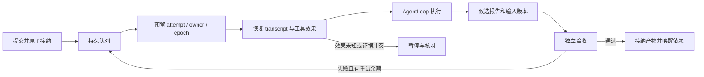

# 持久长任务运行时

`tnb runtime` 是独立本机服务：接纳任务后，关闭提交终端不会取消工作。它复用 tnb 的 AgentLoop、Provider、工具、权限检查和原生沙箱，并增加持久输入路由、调度、工具日志、分层恢复、产物验收和 Run 预算。当前交付范围是单 Agent 编码，以及按需的一层只读子 Agent 协作；旧 Run 保留原委派策略。验证平台为 macOS 和 Linux ARM64 / Bun；本文描述实际代码能力，完整演进目标见[设计](superpowers/specs/2026-11-03-durable-task-runtime-design.md)。

## 使用

已有 Provider 配置保存在 `~/.tnb/models.json`；仍可用 `TNB_HOME` 或 `--config-dir` 指定配置目录。配置和 runtime 控制目录必须位于工作区之外，数据库必须位于本机文件系统。

```sh
# 只读调查；auto 从一个 Agent 开始，有独立任务时才委派。
tnb runtime submit '分析执行循环和错误恢复，给出带文件依据的报告' \
  --cwd /path/to/project --mode auto

# 实际编码：显式开放写入、Shell，并提供可以安全重复执行的验收命令。
tnb runtime submit '修复重试逻辑，补回归测试并通过类型检查' \
  --cwd /path/to/project --allow-write --allow-shell \
  --check 'bun run typecheck' --check 'bun test' --max-budget-usd 5

# 不允许委派时使用 single；multi 要求有界评估，仍可选择不拆分。
tnb runtime submit '修复一个边界条件' --cwd /path/to/project --mode single \
  --allow-write --check 'bun test tests/retry.test.ts'

tnb runtime list
tnb runtime status RUN_ID
tnb runtime result RUN_ID
tnb runtime result RUN_ID --task TASK_ID
tnb runtime events RUN_ID --after 0
tnb runtime pause RUN_ID
tnb runtime resume RUN_ID
tnb runtime cancel RUN_ID

# 服务中断后启动独立后台 owner；不会创建另一套业务任务。
tnb runtime start
# 排空并重启到当前可执行文件版本。
tnb runtime restart
# 如需在当前终端托管服务，可用 tnb runtime serve。
# 排空并停止服务，保留继续执行所需的证据。
tnb runtime stop
```

开发环境可将 `tnb` 替换为 `bun src/entrypoints/cli.ts`。`submit` 默认自动启动独立服务；`--no-start` 要求服务已经运行。首次调用返回 Run/task ID；`result` 返回报告、输入摘要、验收命令和输出。交互界面的 `/runtime list|status|result|events|pause|resume|cancel|storage` 使用同一服务。服务日志位于 `<config-dir>/runtime/service.log`，重新启动前按 4 MiB 轮换一次。

每个任务控制命令可传 `--command-id ID`。重试必须使用同一 ID、同一内容：返回原回执，状态查询才能获得最新状态。不同输入复用 ID 会被拒绝。默认 Run 截止时间是接纳后的 24 小时；CLI、对话工具与 SDK 创建任务时均可指定绝对截止时间，CLI 使用 `--deadline "2026-11-06T18:00:00+08:00"` 这样的带时区 ISO 时间。

## 续期与预算调整

暂停且所有 Attempt 排空后，可以调整原 Run 的经济限制，随后由用户明确恢复：

```text
/task pause
/task limits --extend-hours 24 --max-budget-usd 10
/task status
/task resume
```

命令行等价入口是 `tnb runtime limits RUN_ID --extend-hours 24 --max-budget-usd 10`。也可用 `--deadline ISO-DATE` 设置新的绝对截止时间，两种时间参数互斥。`--extend-hours` 从原截止时间与当前时间中的较晚者延长，最大单次延长一年；重复请求沿原 command ID 重试，不重复加时。`--revision N` 可固定预期 Run 修订号；自然语言 `durable_task limits` 必须带当前修订号并经正常审批，模型只能转交用户明确的额度/截止时间决定，不能自行续期或追加预算。

预算参数是**新的总上限**，不是清空用量后重新分配一份额度。已有上限只允许提高，尚未设置时可以增加上限；上限不能低于已报告费用与未结清预留之和，uncertain 记录不被删除。美元预算仍要求 Provider 配置有效价格，实际账单保证范围与原预算机制相同。更新限制同事务保存审计事件、Run 修订、`run-limits` 与基础配置中的新上限，确保旧配置读取路径也受到限制；`binding-limits` 单独保存原预算值，只用于兼容原能力校验，不参与当前预算准入。不更改任务、模型、工具或文件/Shell 授权；即使过期 Run 已续期，也保持暂停，等待显式 resume。未知副作用仍需先核对，不能靠续期或加额度跳过。

过期问题不会继续弹出或接受回答。授权续期后，原来未回答的问题可以重新呈现，沿用同一 waitId 和问题版本；暂停期间回答仍不会自动恢复任务。

## 在对话中触发

当前主对话增加了 `durable_task` 工具。直接说：

> 把我们刚才讨论的重试机制改造作为后台长任务执行。允许修改代码，用项目的类型检查和相关测试验收；独立调查可以按需委派。

模型会把目标与相关讨论整理成 `objective` 和有界 `context`，沿用当前工作区、Provider 和模型，按现有权限策略申请提交。确认的输入包含写入/Shell 许可、验收命令及可选费用上限。后台 Run 拥有独立预算，不自动与当前聊天的 invocation 额度合并。普通聊天不会仅因为内容长而自动启动任务；模型应在用户明确要求持久/后台执行时调用该工具。

可以直接使用专用长任务命令，`/task`、`/long` 和 `/长任务` 是别名：

```text
/longtask "分析项目重试与恢复机制" --mode auto
/longtask "修复重试逻辑并补测试" --allow-write --allow-shell --check "bun run typecheck"
/longtask status
/longtask result
/task questions
/task answer --question QUESTION_ID --answer "采用 SQLite，继续" --version 1
/longtask pause
/longtask resume
/longtask cancel RUN_ID
/longtask list
```

裸 `/longtask` 显示帮助，不启动服务或任务。提交可以省略 `submit`；查询和控制省略 Run ID 时，优先定位本对话最新创建的任务，没有则选择当前工作区最新任务。`list` 只列当前工作区，多个任务时可指定 Run ID。默认只读，开放写入仍需明确的许可和验收命令。

也可以使用确定的斜杠命令，两种交互界面均支持：

```text
/runtime submit "分析执行循环与恢复机制，给出带源码依据的报告" --mode auto
/runtime submit "修复重试逻辑并补充测试" --allow-write --allow-shell --check "bun run typecheck"
/runtime list
/runtime status RUN_ID
/runtime result RUN_ID
/runtime pause RUN_ID
/runtime resume RUN_ID
```

斜杠提交直接表达用户授权，默认继承当前选择的模型和工作区；带空格的目标要加引号。自然语言控制则经正常工具权限链，支持“刚才任务进度如何”“暂停刚才任务”“继续刚才任务”“给我最终结果”。自然语言暂停/恢复/取消先按动作筛选有效目标，再优先考虑当前对话；唯一目标直接执行，多个目标自动询问，不把已完成历史算作歧义。显式斜杠查询/控制仍保留最近任务便捷规则。恢复意味着继续原任务，不修改其原目标或扩大授权。

来源 session ID、上下文与配置随 Run 持久保存。稳定 handoff key 防止同一次提交被重复创建；相同 key 改目标/权限会拒绝。上下文是模型选取的相关讨论摘要，最多 16 KiB，不是完整聊天记录的复制。此工具只暴露给主对话，不进入子 Agent、fork Skill、Hook agent 或持久 worker 的工具集。Plan 模式和 deny/ask 规则继续生效，不能通过新 Run 绕过它们。

前台正在使用工作区时，后台任务保留在持久队列等待，不消耗模型请求、attempt 或错误重试额度。后台取得工作区后，前台对话临时只开放长任务查询和控制工具，允许继续文字交流；文件工具和 Shell 等待工作区释放后恢复。对话 session 的消息、计量和压缩仍会保存。纯控制路径不重新启动项目插件/生命周期；复用的模型 Hook 使用本轮预算和无业务工具的 handler，需要工作区工具时阻塞；新建且带独立 lifecycle hooks 的会话需使用已有交互界面或显式命令。

更新二进制后重启原来打开的 tnb 对话，并用新版 `tnb runtime restart` 或交互命令 `/runtime restart` 排空、重启旧后台 owner。`start` 对健康的现有服务不重复启动；`restart` 会等待原 owner 释放锁再启动当前版本，保留已有任务、预算、暂停/取消状态和恢复证据。重新启动后只按原规则推进活跃任务，不自行恢复已暂停任务。对话入口检查 owner capability，旧服务不会静默忽略工作区筛选、上下文或资源等待协议。

## 持久提问、定时复查与挂起

参考 [agent-autoloop 的固定源码版本](https://github.com/KKKKhazix/agent-autoloop/tree/cecec75be3ca26e6ca1d6833b50152ee9450088d)，采用“一轮不等人”的机制。worker 的 `durable_wait` 工具支持 `question` 和 `timer`：稳定 key 标识一次等待，`about` 保存已完成的工作、剩余步骤和核实条件；定时复查需要带时区的 ISO 时间，且必须早于 Run 截止时间。相同 key、相同输入复用原等待，相同 key 改内容拒绝；新的问题或下一次复查使用新 key。每 Task 最多 256 次等待，每 Run 最多 4096 次。

等待请求先落 SQLite；工具回执经原 journal/transcript 持久化后，Attempt 以 `waiting` 结束，保存检查点并释放模型、worker 资源和工作区租约。该批后续业务工具会被拒绝。**Attempt 结束不表示 Task 完成**，不会因此生成已验收的业务结果。根、中间、叶 Agent 使用同一机制，single 也能提问和定时续接，不需要先开启多 Agent。

```sh
tnb runtime questions RUN_ID
tnb runtime answer RUN_ID --question QUESTION_ID --answer "采用 SQLite" --version 1
```

长任务需要决定时，**打开的 tnb 交互界面会自动提醒，无需反复查询**。TUI 空闲时自动显示问题与选项，使用上下键和 Enter 作答，或选择 Other 输入自己的答案；无选项的问题直接输入。正在输入草稿、运行前台任务、审批或处理其他弹窗时，先显示待处理提醒，保留当前内容，交互结束后再询问。Esc 仅表示稍后处理，问题不会被取消；界面保留待处理数量。终端 REPL 也会主动展示问题，直接输入选项编号或答案，`/later` 可暂缓。

界面关闭时问题继续持久保存，重新打开当前工作区会自动补提醒；无需恢复原 session。提醒通过鉴权的本地 SSE 状态快照连接发送，不消耗模型请求。连接中断、owner 重启后自动重连并重新读取未处理问题；同工作区多个窗口中一个回答后，其余窗口会撤下对应问题。切换工作区会撤销旧问题的交互，旧弹窗的回答不能跨工作区提交。多问题依次处理，快照每次最多 64 个，回答后推进队列；暂缓仅影响当前界面，不等于服务端已经回答。

`/task questions [RUN_ID]` 仍可查看问题、选项、背景、waitId 和 version；`/task answer [RUN_ID] --question ID --answer "回答" --version N` 保留为明确命令入口。自然语言也可读取问题并提交用户明确的决定；`durable_task answer` 经正常审批，模型不得代用户编造答案。直接在问题界面选择/输入是用户本人回答，不需要模型转述或额外审批。回答核对 Run、问题身份与版本；同一回答重复交付只产生一次信号，不同回答或旧版本被拒绝。回答与信号同事务提交，先到的回答不会因稍后才登记 waiting 而丢失。

未过期的暂停任务可以保存回答，但不会自动恢复 Run；仍需显式 resume。取消后拒绝迟到回答。用户答案仅是原任务内的继续输入，不能开放写入、Shell 或增加预算。等待期间用户可使用已释放的工作区，恢复时重新读取当前文件，最终仍通过版本绑定的验收。

## 状态提醒与连接诊断

除提问外，打开的 TUI/REPL 还会自动显示完成、失败、执行阻塞、预算不足、截止时间到期、存储不足、暂停和取消提醒。提醒区分 Attempt 挂起与 Run 完成，完成仅指当前配置的验收已通过；只读任务的 `report-delivered` 仍不是语义正确性证明。界面不需要调用模型解释这些事件。

状态提醒使用原持久事件 ID，客户端展示后向后台确认送达；确认记录随 SQLite 保留，owner 或界面重启后补发未确认的当前状态，不再次显示已确认的提醒。确认仅表示客户端接收/展示，不代表用户已读，也不代替回答或恢复授权；在确认前崩溃可能重复提醒，不承诺通知的严格 exactly-once。一个窗口确认后，其他窗口同步撤下对应待送达提醒。未打开任何界面时不确认，重新打开可补提醒。

连接状态明确区分连接中、在线、未启动、离线、旧协议不兼容和控制凭据变化。离线时收起问题交互，保留已输入草稿，不把连接失败解释为任务成功；恢复连接后重新读取问题和状态快照。旧 owner 不支持完整提醒时会明确提示升级重启，不静默重试假装在线。握手有 5 秒上限，15 秒心跳配合 45 秒无响应检测；后台 fatal 导致 dispatch 停止也会显示重启入口。该功能不会自动重启服务或扩大授权，用户可显式使用 `/runtime start|restart|stop`。

定时唤醒通过持久 outbox 和信号实现，服务重启扫描已到期条件；不会为了等待时间而调用模型。调度采用状态提交通知与最近到期定时器，保留 30 秒磁盘容量检查，不再每 100 ms 扫描调度队列，也不保留父任务每 25 ms 的轮询。父任务等待子结果时也会结束 Attempt；子任务全部验收后，结果和引用作为持久 continuation 交给原父任务。

同一 Run 的无写入、无验收命令的只读执行可以共享受引用计数保护的工作区租约；最后一个持有者退出才释放。编码与有验收命令的执行仍独占工作区，不会借用已挂起祖先的锁。等待不占活跃 Agent 名额，也不额外领取预算。

该功能复用现有 schema v2 的 records/signals/outbox，没有引入第二套调度或模型循环。旧任务仍受能力指纹检查：工具集、模型或权限与保存指纹不一致时保守停止，需核对并新建 Run，不会自动放宽能力；经专用命令调整经济限制不改变该指纹。本轮提醒呈现在 tnb 交互界面内；外部 Webhook 接入、可撤回/编辑的问题、系统桌面或外部通道通知、系统服务托管、任意事件链与跨机器协调未开放。升级此功能后需重启旧 owner，让 `/health` 的 `lifecycleNotifications`、`adjustableLimits` 为 true。

## 业务流程与验收



Run 接纳、任务、事件、命令回执和调度 outbox 同事务提交。SQLite 使用 WAL / FULL synchronous / 外键；schema v1 到 v2 原子迁移，未知数据库或较新 schema 会被拒绝。持久消息、操作和配置保存在 `runtime_records`，独立于传统会话文件。

执行时先取得工作区锁、分配 attempt，再开放模型和工具。租约每 10 秒续期，有效期 60 秒；旧 owner/epoch 或过期 attempt 不得继续派发。每次模型请求、工具授权、工具派发和候选提交都检查当前执行权。前台 CLI 调用与持久 worker 共用按用户、规范工作区路径生成的锁，覆盖已声明附加目录；不同 `TNB_HOME` 也不能同时占用相同路径。任意编辑器、旧版本进程、绕过公开入口的宿主插件不受这把合作锁强制隔离，验收仍需检查文件内容版本。不要同时运行覆盖同一工作树的外部写入程序。

模型的完成报告只是 candidate。运行时先确认所需子任务已接纳，再运行用户明确授权的 `--check`，比较检查前后的文件清单，并保存不可变、按内容寻址的验收证据。检查失败时，失败原因先按稳定 delivery key 落入上下文，再安排有限次修复。超过重试额度后 Run 失败。只读任务使用 `report-delivered` 验收，证明交付了绑定输入的报告，不表示已经自动证明分析语义正确。

文件清单包含 dirty/untracked 文本、文件模式和符号链接值；排除 `.git`、`node_modules`、`dist`、`build`、`coverage`、`.tnb`。这些排除目录、外部依赖和构建环境不在输入摘要保证内。代码改动和实际交付文件仍位于用户工作区；数据库备份不会备份整个项目，也不自动撤销文件修改。

## 模型窗口与长任务上下文

每个 Task 独立管理上下文。生产 Worker 使用 Provider 配置的 `contextWindow`，按实际请求计算可用输入空间：扣除输出额度和 5% 安全余量（最少 256、最多 4096），再计算系统提示、工具描述/schema、任务目标、执行检查点和消息历史的开销。当前使用 UTF-8 字节加消息开销的保守估计，不是模型的精确 tokenizer；因此可能提前压缩。自定义 Worker factory 未提供窗口时按 32k 处理。接纳配置中的 `compactThreshold: 24000` 仅作为历史压缩阈值上限，不能绕过模型容量约束。

每轮先限制活动上下文中的巨大工具结果，再复用工具结果裁剪、完整摘要、上下文折叠的分层流程。原始结果先落盘，活动上下文中的替换不修改原始证据。长任务允许在完整工具轮次之间切分，尽量保留最近六条消息对应的完整调用/结果；若这段仍超过实际窗口，继续缩减至能容纳的完整后缀，不保证硬保留六条。

摘要请求同样受窗口限制：把历史序列化为不可信证据，分块递进合并摘要，禁用工具，单次输出最多 2048 token，最多 64 次请求。Provider 报摘要上下文超限时缩小分块，未完成、空、过大或工具调用式摘要均不接纳。摘要调用经过原 Run 的持久费用预留，较小输出限制同时约束预留和实际请求；失败请求的 uncertain 预留仍保留。主请求超限会缩小上下文目标并由 AgentLoop 有限重试。摘要服务失败可以折叠旧历史；取消、执行权失效、预算耗尽和无效用量不能通过折叠继续。

原始 Run/Task 目标、工作区、写入/Shell 许可、验收命令和原始对话参考固定在每次请求的系统上下文中，历史摘要不能覆盖这些字段。最近六项工具回执构成独立的 `task-progress` 检查点，与消息 `written` 回执和提交事件在同一 SQLite 事务保存；压缩不重写检查点。恢复 Attempt 还会固定注入最近一次等待的 `about` 和最近一次已回答的用户决定；更早的回答仍可从本任务记录取回。检查点中的输出提示只是历史证据，不代表业务完成或新的授权。等待时的 `about`、后续答案、完整操作和最终验收证据也继续按原协议持久保存。

模型可通过只读 `durable_recall` 按关键词/游标查找本 Task 的消息 delivery，再按 delivery/offset 分页取回原始记录；返回 `compact`、是否含工具结果和下一页位置，便于区分原始结果与摘要。该工具不接受其他 Task ID、文件路径或 SQL，不开放 Worker 对 runtime 控制目录的文件访问。原始记录中的内容仍是不可信证据。它只投影本任务已收到的数据，不改变既有文件/Shell 能力指纹；模型、外部工具和权限变化仍按原规则拒绝。

压缩边界及策略、估算大小、实际输入上限、工具结果裁剪数、摘要失败标记写入 `context.compacted` 事件，边界和元数据参与同一 delivery 摘要校验。重启重放压缩边界，使用替换后的活动历史，不把全部归档重新塞回模型。若必要的固定目标、指令和工具定义本身已超出窗口，或恢复无法获得更小的有效历史，Run 记录错误并暂停，要求缩小任务或使用更大窗口模型。

这套机制允许多次压缩续跑，不承诺无限任务、摘要无损或连续数小时稳定性。Provider 的实际窗口必须正确配置；遇到网关实际路由容量小于配置仍可能有限恢复后暂停。每 Task transcript 的 64 MiB 上限、服务存储限制、Run 截止时间、轮次及费用预算仍生效。丢失于摘要中的语义约束应通过原始记录和当前事实复核，最终结果仍由独立验收接纳。

## 对话续接与任务归属

```text
/task followup RUN_ID --text "补充：还要核对错误恢复的边界"
/task routing
/task routing --pending
/task routing --pending --before-input INPUT_ID
/task followup RUN_ID --resolve-input INPUT_ID --revision 1
```

也可使用 `tnb runtime followup/routing` 或 `/runtime`。只有唯一合适任务时可省略 RUN_ID；同工作区多候选不会按主题或最近时间猜测，而是保存 clarify 决定并通过已有自动问答界面提示选择。自然语言控制同样需明确目标。选择绑定原 inputId/revision、会话与候选范围，交付原始补充文字，不把选项文字当成新增要求。`routing` 可检查已接纳、待澄清和拒绝原因；CLI 的 `--input-id` 可用于重投同一来源事件。

自然语言控制身份绑定 session、持久工具 history scope 与 call ID；同一次调用重放先复用原归属决定，不因原目标结束而改选剩余任务，后续同样文字的新回合形成新决定。直接嵌入工具的宿主也可提供 `sourceInputId`。`routing` 首页优先显示未决归属，`--pending` 独立查询未决记录（每页最多 256），用本页最后一个 inputId 作为 `--before-input` 取下一页。自动问答直接查询有候选的未决记录，每批最多 32 项；普通历史和没有候选的旧决定不会把有效问题挤掉。候选在查询后收敛到一个时，也仍能显示并选择。

输入原文、来源、归属决定、Task 输入修订和唤醒 outbox 在事务内保存。Worker 在完整工具轮次后消费持久 inbox，用稳定 delivery ID 追加 transcript，再确认交付；崩溃后修复回执不重复追加。不更改已经发送的模型请求或工具 history scope。新增要求使旧 candidate/验收失效，并在原任务增量执行，不为此消耗失败修复次数。最新要求固定注入系统上下文，原始输入和更早证据仍留在 transcript，可有界取回。

暂停任务接纳补充但不自动恢复；等待用户回答的任务也不跳过等待。取消或完成的任务拒绝续接，需要 `tnb runtime submit '后续任务' --successor RUN_ID --cwd /path/to/project` 显式新建。补充和路由选择不能增加写入、Shell 或费用授权。无候选的 clarify 输入不能直接选择以后新建的任务；请明确提交或重新发出补充。

## 单 Agent 与多 Agent

新 Run 使用执行策略 v2，输入路由与执行策略分别记录。Router 判断原始输入属于哪个任务、是补充还是控制；Worker 判断已接纳的任务是否值得拆分。自然语言复用主对话已有模型回合，不为每条输入额外调用 Router 模型。普通讨论不会自动成为后台任务。

| 模式 | 新 Run 的实际行为 |
| --- | --- |
| single | 一个业务 Agent，统一准入拒绝委派 |
| auto（默认） | 从直接执行开始，按需提出独立调查；每批最多两个，Run 最多两个活跃业务 Agent |
| multi | 初步调查后四个模型回合内必须形成评估，可用 `assess_delegation` 选择 direct，也可用完整委派提案记录分工选择；每批最多四个，Run 最多四个活跃业务 Agent |

v2 默认一层委派。提案必须声明稳定 key、问题、独立性理由、scope、evidenceRefs、交付物、验收标准、required/辅助性质、子任务轮次与请求数。运行时检查实际成功的工具引用、授权工作区、深度、重复工作和额度；scope 是调查合同，不等同于新增一层文件沙箱。子任务仍只能访问原授权工作区并保持只读。决策、合同、拒绝原因、计划修订和子任务接纳持久保存，不依赖模型自填收益分数。

委派以 `(parent_task_id, key)` 固定业务身份，并核对完整提案摘要。相同 key、相同输入沿用已有任务；同 key 改输入会拒绝。父任务等待期间结束 Attempt、保留 Task 身份和持久恢复条件，释放执行资源；子任务验收后向原父任务交付结果，父恢复时重新申请并发名额。没有 strategyVersion 的旧 Run 保持原工具 schema、能力指纹及最多两层委派，不在升级时静默改策略。

子 Agent 用 `complete_investigation` 提交 summary、evidenceRefs、uncertainties，工具回执落盘后直接结束本次调查，不再多发一次模型请求；合法的最终 JSON 报告也可接纳。格式错误最多提示修复两次，仍消耗原额度。提交后崩溃保留原报告与输入摘要，不用新工作区摘要冒充旧证据。`input` 表示需求来源，`tool:<call-id>` 必须是本 Task 的实际成功工具操作；这只证明引用来源，不证明结论语义正确。父 Agent 必须用 `review_child_result` 明确核实当前结果及输入版本，报告全文可通过 `durable_recall` 分页取回。

验收失败时先持久标记结构化报告失效，再投递修复提示。失效报告不能走“已提交报告直接复用”的恢复路径，也不阻止新的调查工具；子 Agent 在原限额内重新核实并提交替代报告。即使在失效标记与修复提示之间崩溃，重启也不会重新采用旧报告。原候选产物和失效事件保留审计依据；无验收失败的正常提交恢复仍不额外调用模型。

必需分支失败不能在事后改为辅助；辅助分支失败需父任务明确接管，最终产物保留运行时附加的限制说明。新 Run 默认最多 256 次物理模型请求，子合同最多 32 次，维护性摘要同样计入。保留最后两次 Run 请求及按父请求估算的费用用于父整合；未知费用预留不清零。容量暂缺排队、合同或额度不成立拒绝，并保存原因。尚无同任务同预算的质量/成本基准，不能据此断言多 Agent 更快或更好。

子结果通过工具 operation 和 transcript delivery 去重；重启不会重新创建已经接纳的子任务。并行只读批次同事务接纳，失败不会留下半个批次。对子项目的调查只允许显式 `--allow-workspace /path` 注册的工作区，仍使用同一 owner、Run ID、预算和结果关联，不是远端服务间的消息协议。各工作区的报告是其已记录输入版本的证据，不保证多个项目在同一个物理时刻形成联合快照。

当前不开放子 Agent 写代码、隔离并行写入、自动 worktree 合并、跨 daemon/机器协作。`agent` 输入若请求未知写权限会拒绝。没有将旧 Skill、MCP、Hook、插件或 workflow 入口接入持久执行；这些能力仍在传统会话中使用，不能借其绕过新运行时的委派准入。`/health` 返回实际 capability 清单。

## 中断与恢复

工具调用先在 DB 分配稳定 ID，再追加并 fsync v2 journal 的 intended / dispatched / settled 记录。ID 包含 task、规范化的完整 history scope 和 Provider call ID；scope 不受 JSON 对象键顺序影响。原传统 journal 的格式和 scope 协议保持兼容。

| 中断位置 | 恢复动作 |
| --- | --- |
| DB 已保存 intent，journal 还未追加 | 使用原 operation ID 补齐 intended |
| 已派发且工具声明可安全重放 | 同时检查保存时和当前的 replay 策略，才允许再次执行 |
| 写入/Shell 已派发，结果未持久确认 | 保持 unknown，暂停，禁止盲目重跑 |
| 结果已 fsync，DB 尚未镜像 | 从精确 journal 关联修复 DB，复用结果 |
| transcript 已追加，送达标记未提交 | 按 delivery ID/digest 去重，不再次追加 |
| 模型终态已持久化，candidate 尚未提交 | 复用终态报告，不额外请求模型；验收仍检查输入版本 |
| 子任务执行中或成功未消费 | 沿原 parent/key 找回任务和结果，叶到父推进 |
| 用户 pause/cancel 或 deadline 到期 | 优先阻止派发、排空；不会通过重启撤回控制意图 |
| journal 丢失、倒退、损坏或能力指纹变化 | 停止并暴露核对状态，不猜测成功 |

模型路由、API、endpoint、模型规格、工具 schema/access、项目指令和权限规则参与执行指纹。配置不兼容时暂停，不静默把旧调用交给新能力。密钥值不写入 prompt 或工具环境。模型请求中断后没有 usage 的费用预留保留为 uncertain；恢复不将其当成零花费。

unknown 的操作需要先实际核实外部状态，再提交确认：

```sh
tnb runtime status RUN_ID
# 确认任务已排空，并检查文件/外部系统中的真实结果。
tnb runtime reconcile RUN_ID --task TASK_ID --operation OPERATION_ID \
  --result '已核实操作完成，文件内容为……'
tnb runtime resume RUN_ID
```

`reconcile` 只记录确认结果，不执行原操作。无法确认时保持阻塞；需要执行新的动作时应明确建立新工作。暂停、取消和服务停止不会回滚已经发生的副作用。普通命令、写入、远程系统不存在本运行时可承诺的全局 exactly-once；正确恢复也包括保守阻塞。崩溃后的 Shell 后代或其他外部程序是否仍存活须在核对时检查，单凭新 owner 获得锁不能证明旧外部效果已消失。

## 权限、沙箱和资源边界

控制服务使用私有 Unix socket 和每次启动轮换的 Bearer 凭据；所有路由均鉴权。服务先获取所有者锁，再打开和迁移 DB。Shell 只获得受限环境、工作区内独立 HOME/TMP；模型密钥不传入子进程。编码和检查要求原生沙箱，禁用网络，拒绝 PTY/后台 Shell。macOS 效果测试实际验证了工作区写入、控制密钥和外部文件读取拒绝、HTTP/Unix socket 连接拒绝。沙箱仍允许必要系统和工具安装目录的读取，不能宣称隔离同 UID 的任意宿主代码。

提交的写入许可不绕过设置中的 deny/ask 规则；无人值守执行遇到需要询问的操作会拒绝。验收命令只执行提交时列出的精确命令，且受相同的 deny/ask 约束。不要把有发布、付费或其他不可重复副作用的命令当作 `--check`。对被中断的检查，用户授权其可以再次执行；工作区外效果不属于文件摘要的证明范围。

| 资源 | 当前上限 |
| --- | --- |
| 活跃业务 worker / 模型流 | 进程各 8；新 Run auto 2、multi 4、single 1；同用户跨进程模型请求每资源域 4、总计 8 |
| 委派 | 新 Run 深度 1，auto 批次 2 / multi 批次 4，每 Run 64 个动态任务；旧 Run 保留原策略 |
| 模型请求 | 新 Run 默认 256 次物理请求；子合同 1–32 次，含摘要请求；机器协调等待队列 256 |
| 路由与补充输入 | 新工作受 10,000 条路由载荷准入上限约束；既有任务的控制/回答及控制澄清可超出该上限；每 Task 最多 256 条 inbox |
| 模型响应 / 单请求时间 | 2 MiB / 10 分钟 |
| 单条 record / artifact | 1 MiB |
| 单任务 transcript / 单 operation journal | 64 MiB / 8 MiB |
| 输入扫描 | 20,000 项、深度 64、单文件 16 MiB、总文件 256 MiB |
| 状态水位 | 2 GiB，或剩余磁盘不足 256 MiB 时停止接纳并暂停活跃 Run |
| 元数据集合读取 | 每种集合最多 10,000 条，超过后显式停止，不截断恢复证据 |

状态水位每 30 秒检查，不是严格文件系统配额。真实 I/O 失败会停止派发并报告故障，不伪造已持久化成功。费用估计、归一化 usage、摘要调用和所有子任务使用同一 Run 账本；请求发送前预留，完整 usage 后结算，不确定预留跨重启保留。Provider 内部重试在持久 worker 中关闭，每次物理请求由持久调度重新计量；不配置 fallback。该额度是本地准入控制，不等同于外部账单的硬封顶。

跨进程协调位于同用户私有 `/tmp/tnb-coordinator-UID/leases.sqlite`，独立于 `TNB_HOME`，只保存租约与资源域哈希，不保存凭据。相同 Provider endpoint/凭据/请求头的别名共享资源域，规范化请求头顺序和 endpoint 尾斜杠；同域按项目轮转。请求先获得机器名额再预留持久费用，取消删除等待票据，进程死亡或 PID 出生身份变化后回收租约；无法验证的活跃持有者保守保留。该协议需参与进程合作，不是操作系统安全边界，也不能限制旧版本或其他客户端。

工作区租约按真实规范路径检查相同目录、父子目录及符号链接别名，防止多终端分别启动时绕过互斥；不同独立目录可并行。同一次调用显式声明的多个根复用调用身份，仍保留旧的精确目录锁以兼容旧进程。

## 备份、恢复与清理

```sh
tnb runtime stop
# stop 返回的是停止请求；等服务退出/锁释放后再维护。
tnb runtime backup /path/to/new-backup-directory
tnb runtime storage
# 只清理已结束、没有在途或未知效果的 Run。
tnb runtime prune TERMINAL_RUN_ID
# 目标必须是空 runtime 目录；通常使用新的 config-dir，配置与密钥另行保管。
tnb runtime restore /path/to/backup --config-dir /path/to/restored-config
```

维护操作与服务共用 owner 锁，活跃服务会拒绝离线备份/恢复/清理。备份先核对/修复 journal/transcript bridge，再保存包含 WAL 已提交页的独立 SQLite 镜像、操作日志和不可变产物；逐文件校验，manifest 最后发布。单数据库备份镜像限制 512 MiB，恢复总量限制 10 GiB。不会导出控制密钥、Provider 配置、Shell 日志或用户项目。恢复逐文件有界校验，整个暂存目录验证后才发布；有问题的备份不会留下半个可执行数据库。恢复的活跃 Run 改为 paused，须核对快照之后的效果再显式 resume；原 owner 必须已永久退役，不能同时运行原数据和恢复副本。

清理保留 command ID 回执作为去重墓碑，删除所选 Run 的状态/事件/任务日志，并回收不再被任何保留任务、事件或执行记录引用的产物。已清理的回执可能包含失效 artifact 引用，这是显式删除的结果，不会把 ID 再用成一项新业务。磁盘空间充足时整理 SQLite 以释放页。旧 Goal/Task/Workflow 不自动导入，也不改写旧 session；只有新 runtime 接纳的任务拥有这里的恢复协议。

schema v4 从 v1/v2/v3 自动迁移，保留原 Run、能力绑定及策略，新增路由身份墓碑与未决索引。普通历史满时拒绝新工作，暂停、取消、恢复、回答和控制澄清仍可记录审计，不因普通历史配额回滚控制。它们仍可能增加存储占用，10,000 不是控制记录的硬配额。

离线 `prune TERMINAL_RUN_ID` 同时删除该 Run 已关联的路由载荷，并保留 inputId、workspace 和原决定摘要作为墓碑；普通命令去重回执仍保留。旧 inputId 换新 command ID 重投会明确拒绝，不能重新创建旧业务；原 command ID 重试仍返回原回执。墓碑随备份和恢复保存。未关联目标的未决问题不隐式清理，尚无独立撤销命令。墓碑和命令回执继续占空间，不是无限运行承诺，不应手工删行绕过去重。

## 对话中的任务工作台

全屏 TUI 用 **Ctrl+T** 或不带参数的 **`/task`、`/tasks`** 打开工作台，Tab 切换任务、待决定、排队输入。任务页合并当前工作区的持久 Run、原有 Agent 工作项和 Shell/PTY；持久 Run 优先展示活跃项，最多显示最近 32 项，完整历史仍用 `tnb runtime list`。终端尺寸受限时可用方向键和 PgUp/PgDn 查看详情。状态来自运行时记录，包括模型请求、工具执行、上下文整理、工作区/执行容量等待和实际完成的验收计数，不估算百分比。

**Ctrl+Q** 直接打开同一份持久输入队列的快捷管理面板，支持完整预览、Enter/E 取回和 D/Delete 后 Y 确认删除；切换会话只脱离原队列，不删除原会话保存的数据。两个入口共用派发身份，不会各执行一次。

| 操作 | 行为 |
| --- | --- |
| 前台执行时输入普通内容并 Enter | 保存到当前会话队列，前台结束后按顺序执行；不会发给后台 Run |
| 选中 Run → F | 将编辑器切为该任务的补充模式；Enter 保存补充，Esc 返回普通对话；保存与工具安全边界实际送达分别展示 |
| 选中 Run → Enter | 查看子任务、独立后台用量、交付报告、验收输出、最近已确认写入预览和待核对操作 |
| 选中 Run → P / R / X | 暂停 / 恢复 / 取消；取消需要 Y 确认，暂停和取消的排空过程继续显示 |
| 选中 Run → L | 将带 revision 的限制命令放入空编辑器，填入明确额度或期限后提交；未知操作场景只准备状态查询 |
| 待决定 → Enter | 主动打开原问答组件，即使主编辑器有草稿也可回答；前台忙时等它结束，避免抢占当前审批 |
| 排队输入 → E / D | 取回编辑 / 确认删除；取回后原输入继续保存，显式提交才重新进入队列 |
| 选中 Shell/PTY → I / K | 打开原输出与 PTY 输入面板 / 确认终止；Shell 面板中再按 I 输入，K 同样先确认 |

前台队列位于配置目录的私有 `ui-queues/`，按 session 保存，保留粘贴和图片引用元数据，最多 32 项 / 2 MiB。先原子写入并 fsync，再显示“已保存”；派发前记录为 `uncertain`，成功完成后才删除。关闭或失败留下的 uncertain 项不会自动重复，须先核对会话历史，再取回编辑或删除。`draft` 项在同会话重开时可恢复到空编辑器，并阻止后续项越过它。这里不是跨多个前台进程同时编辑同一会话的协调协议，队列文件不保存图片文件本体。执行中不排队斜杠命令，后台控制仍可通过工作台或另一终端使用。

待回答问题沿原持久 wait 协议恢复和提醒；TUI 中失败/稍后处理的选项与自定义回答草稿保留在本次进程内，重开后恢复的是未决问题，不承诺恢复未提交回答文字。审批支持 PgUp/PgDn 查看完整命令、工作目录、文件替换或计划和可保存规则；选项明确区分单次、会话和项目规则。回答业务问题不会增加执行权限。

工作台仅展示并调用已有控制协议，不构造新 owner，也不自动恢复未知操作、提高预算或伪造核对结果。未知操作在详情中列出 task/operation 与输入，用户实际核对后用显式 `tnb runtime reconcile` 提交结果，再恢复。前台用量和后台 Run 用量分开显示；未配置/未确认价格不显示为免费。完成通知区分“报告交付”和“配置的验收命令通过”；文件预览只覆盖最近 40 个成功 write/edit 回执，不代替完整 Git diff 或 Shell 改动审阅。

普通 REPL 保持串行输入，`/task`、`/tasks` 输出任务概览；执行中可编辑、自动排队和工作台快捷键属于全屏 TUI。更新可执行文件后，现有独立后台服务需显式 `tnb runtime restart` 才具有新的展示接口，UI 不会自动重启运行中的服务。

## 源码与验证

| 模块 | 职责 |
| --- | --- |
| `schema.ts` / `store.ts` / `commands.ts` | schema、事务、revision、租约、命令去重、等待和队列 |
| `journal.ts` / `transcript.ts` | 外部效果与会话证据、稳定调用和送达身份、压缩边界 |
| `engine.ts` | owner、调度、各级执行、控制传播、恢复与验收 |
| `routing.ts` / `delegation.ts` | 原文归属、澄清、持久 inbox、提案和证据报告协议 |
| `../usage/coordinator.ts` | 跨进程请求容量、公平排队与工作区冲突注册 |
| `worker.ts` / `workspace.ts` | 原工具/Provider 组合、权限与原生沙箱、前后台工作区互斥 |
| `budget.ts` / `artifacts.ts` | 共享费用、请求并发、候选和验证产物、输入版本 |
| `server.ts` / `entrypoints/runtime.ts` | 鉴权服务、命令串行化、CLI 与后台启动 |
| `activity.ts` / `presentation.ts` / `attention-stream.ts` | 持久展示阶段、工作区内任务/交付投影及实时刷新 |
| `ui/input-queue.ts` / `ui/workbench*.tsx` / `ui/app.tsx` | 前台输入保存、统一任务面板及沿用原协议的交互控制 |
| `maintenance.ts` | 离线备份、校验恢复、保留与清理 |

Bun 进程内可从 `tnb/runtime` 导入服务或底层类型。生产使用 `serveDurableRuntime`，它保证先取得 owner 锁再开 DB；直接使用 `DurableRuntime` 的宿主也必须保证同样的所有权顺序。该 API 不提供远端多服务一致性。

macOS 回归覆盖存储事务 SIGKILL、真实三级 Agent SIGKILL、终态复用、结果未知后核对继续、只读并行、父等待/取消后代、文件版本失效、验收修复、费用不确定预留、离线恢复、Unix 鉴权和真实 CLI 独立服务。模型测试全部使用脚本 transport 或本地 HTTP SSE fixture，不调用真实付费模型。实现审阅和支持范围见[审阅记录](superpowers/specs/2026-11-03-durable-task-runtime-review.md)。P2 隔离并行实现和 P3 多服务协作仍是后续设计，未计作本次验证通过。
