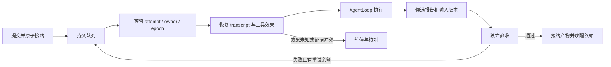

# 持久长任务运行时

`tnb runtime` 是独立本机服务：接纳任务后，关闭提交终端不会取消工作。它复用 tnb 的 AgentLoop、Provider、工具、权限检查和原生沙箱，并增加持久调度、工具日志、分层恢复、产物验收和 Run 预算。当前交付范围是单 Agent 编码，以及按需、最多三级的只读 Agent 协作。验证平台为 macOS / Bun；本文描述实际代码能力，完整演进目标见[设计](superpowers/specs/2026-11-03-durable-task-runtime-design.md)。

## 使用

已有 Provider 配置保存在 `~/.tnb/models.json`；仍可用 `TNB_HOME` 或 `--config-dir` 指定配置目录。配置和 runtime 控制目录必须位于工作区之外，数据库必须位于本机文件系统。

```sh
# 只读调查；auto 从一个 Agent 开始，有独立任务时才委派。
tnb runtime submit '分析执行循环和错误恢复，给出带文件依据的报告' \
  --cwd /path/to/project --mode auto

# 实际编码：显式开放写入、Shell，并提供可以安全重复执行的验收命令。
tnb runtime submit '修复重试逻辑，补回归测试并通过类型检查' \
  --cwd /path/to/project --allow-write --allow-shell \
  --check 'bun run typecheck' --check 'bun test' --max-budget-usd 5

# 不允许委派时使用 single；multi 表示优先考虑独立分工，不强制创建角色。
tnb runtime submit '修复一个边界条件' --cwd /path/to/project --mode single \
  --allow-write --check 'bun test tests/retry.test.ts'

tnb runtime list
tnb runtime status RUN_ID
tnb runtime result RUN_ID
tnb runtime result RUN_ID --task TASK_ID
tnb runtime events RUN_ID --after 0
tnb runtime pause RUN_ID
tnb runtime resume RUN_ID
tnb runtime cancel RUN_ID

# 服务中断后重新启动原目录；不会创建另一套业务任务。
tnb runtime serve
# 排空并停止服务，保留继续执行所需的证据。
tnb runtime stop
```

开发环境可将 `tnb` 替换为 `bun src/entrypoints/cli.ts`。`submit` 默认自动启动独立服务；`--no-start` 要求服务已经运行。首次调用返回 Run/task ID；`result` 返回报告、输入摘要、验收命令和输出。交互界面的 `/runtime list|status|result|events|pause|resume|cancel|storage` 使用同一服务。服务日志位于 `<config-dir>/runtime/service.log`，重新启动前按 4 MiB 轮换一次。

每个控制命令可传 `--command-id ID`。重试必须使用同一 ID、同一内容：返回原回执，状态查询才能获得最新状态。不同输入复用 ID 会被拒绝。默认 Run 截止时间是接纳后的 24 小时；当前 CLI 不提供预算追加、截止时间延长或运行中扩大权限，过期后应另建明确授权的新 Run。SDK `submit` 可在创建时传绝对截止时间。

## 在对话中触发

当前主对话增加了 `durable_task` 工具。直接说：

> 把我们刚才讨论的重试机制改造作为后台长任务执行。允许修改代码，用项目的类型检查和相关测试验收；独立调查可以按需委派。

模型会把目标与相关讨论整理成 `objective` 和有界 `context`，沿用当前工作区、Provider 和模型，按现有权限策略申请提交。确认的输入包含写入/Shell 许可、验收命令及可选费用上限。后台 Run 拥有独立预算，不自动与当前聊天的 invocation 额度合并。普通聊天不会仅因为内容长而自动启动任务；模型应在用户明确要求持久/后台执行时调用该工具。

可以直接使用专用长任务命令，`/task`、`/long` 和 `/长任务` 是别名：

```text
/longtask "分析项目重试与恢复机制" --mode auto
/longtask "修复重试逻辑并补测试" --allow-write --allow-shell --check "bun run typecheck"
/longtask status
/longtask result
/longtask pause
/longtask resume
/longtask cancel RUN_ID
/longtask list
```

裸 `/longtask` 显示帮助，不启动服务或任务。提交可以省略 `submit`；查询和控制省略 Run ID 时，优先定位本对话最新创建的任务，没有则选择当前工作区最新任务。`list` 只列当前工作区，多个任务时可指定 Run ID。默认只读，开放写入仍需明确的许可和验收命令。

也可以使用确定的斜杠命令，两种交互界面均支持：

```text
/runtime submit "分析执行循环与恢复机制，给出带源码依据的报告" --mode auto
/runtime submit "修复重试逻辑并补充测试" --allow-write --allow-shell --check "bun run typecheck"
/runtime list
/runtime status RUN_ID
/runtime result RUN_ID
/runtime pause RUN_ID
/runtime resume RUN_ID
```

斜杠提交直接表达用户授权，默认继承当前选择的模型和工作区；带空格的目标要加引号。自然语言控制则经正常工具权限链，支持“刚才任务进度如何”“暂停刚才任务”“继续刚才任务”“给我最终结果”。省略 Run ID 时，工具先找当前对话最新创建的 Run，再找当前工作区最新 Run；多个任务时应明确 Run ID。恢复意味着继续原任务，不修改其原目标或扩大授权。

来源 session ID、上下文与配置随 Run 持久保存。稳定 handoff key 防止同一次提交被重复创建；相同 key 改目标/权限会拒绝。上下文是模型选取的相关讨论摘要，最多 16 KiB，不是完整聊天记录的复制。此工具只暴露给主对话，不进入子 Agent、fork Skill、Hook agent 或持久 worker 的工具集。Plan 模式和 deny/ask 规则继续生效，不能通过新 Run 绕过它们。

前台正在使用工作区时，后台任务保留在持久队列等待，不消耗模型请求、attempt 或错误重试额度。后台取得工作区后，前台对话临时只开放长任务查询和控制工具，允许继续文字交流；文件工具和 Shell 等待工作区释放后恢复。对话 session 的消息、计量和压缩仍会保存。纯控制路径不重新启动项目插件/生命周期；复用的模型 Hook 使用本轮预算和无业务工具的 handler，需要工作区工具时阻塞；新建且带独立 lifecycle hooks 的会话需使用已有交互界面或显式命令。

更新二进制后要重启原来打开的 tnb 对话；如果旧后台 owner 尚在运行，先用 `tnb runtime stop` 停止，再提交。对话入口检查 owner capability，旧服务不会静默忽略工作区筛选、上下文或资源等待协议。已有持久任务保留，重新启动后依原恢复规则处理。

## 业务流程与验收



Run 接纳、任务、事件、命令回执和调度 outbox 同事务提交。SQLite 使用 WAL / FULL synchronous / 外键；schema v1 到 v2 原子迁移，未知数据库或较新 schema 会被拒绝。持久消息、操作和配置保存在 `runtime_records`，独立于传统会话文件。

执行时先取得工作区锁、分配 attempt，再开放模型和工具。租约每 10 秒续期，有效期 60 秒；旧 owner/epoch 或过期 attempt 不得继续派发。每次模型请求、工具授权、工具派发和候选提交都检查当前执行权。前台 CLI 调用与持久 worker 共用按用户、规范工作区路径生成的锁，覆盖已声明附加目录；不同 `TNB_HOME` 也不能同时占用相同路径。任意编辑器、旧版本进程、绕过公开入口的宿主插件不受这把合作锁强制隔离，验收仍需检查文件内容版本。不要同时运行覆盖同一工作树的外部写入程序。

模型的完成报告只是 candidate。运行时先确认所需子任务已接纳，再运行用户明确授权的 `--check`，比较检查前后的文件清单，并保存不可变、按内容寻址的验收证据。检查失败时，失败原因先按稳定 delivery key 落入上下文，再安排有限次修复。超过重试额度后 Run 失败。只读任务使用 `report-delivered` 验收，证明交付了绑定输入的报告，不表示已经自动证明分析语义正确。

文件清单包含 dirty/untracked 文本、文件模式和符号链接值；排除 `.git`、`node_modules`、`dist`、`build`、`coverage`、`.tnb`。这些排除目录、外部依赖和构建环境不在输入摘要保证内。代码改动和实际交付文件仍位于用户工作区；数据库备份不会备份整个项目，也不自动撤销文件修改。

## 单 Agent 与多 Agent

默认 `auto` 不预建角色。模型可提出一个调查或一批最多四个独立调查，并说明理由；运行时检查 single 约束、祖先身份、深度、授权工作区、任务数和并发额度。每个接纳事件记录只读权限、模式、理由和计划修订号。判定不依赖未经评测的固定收益分数；尚未进行真实付费模型的质量/费用对比，不宣称多 Agent 一定更快或更好。

委派以 `(parent_task_id, key)` 固定业务身份，并核对 prompt/workspace 的输入摘要。相同 key、相同输入沿用已有任务；同 key 改输入会拒绝。父任务等待期间保留恢复身份、释放业务执行槽和模型流槽，子任务验收后才返回结果；父恢复时重新申请并发名额。中间 Agent 使用相同机制，最多到根—中间—叶三级。孙级 Agent 不再获得 `agent` 工具。

子结果通过工具 operation 和 transcript delivery 去重；重启不会重新创建已经接纳的子任务。并行只读批次同事务接纳，失败不会留下半个批次。对子项目的调查只允许显式 `--allow-workspace /path` 注册的工作区，仍使用同一 owner、Run ID、预算和结果关联，不是远端服务间的消息协议。各工作区的报告是其已记录输入版本的证据，不保证多个项目在同一个物理时刻形成联合快照。

当前不开放子 Agent 写代码、隔离并行写入、自动 worktree 合并、跨 daemon/机器协作。`agent` 输入若请求未知写权限会拒绝。没有将旧 Skill、MCP、Hook、插件或 workflow 入口接入持久执行；这些能力仍在传统会话中使用，不能借其绕过新运行时的委派准入。`/health` 返回实际 capability 清单。

## 中断与恢复

工具调用先在 DB 分配稳定 ID，再追加并 fsync v2 journal 的 intended / dispatched / settled 记录。ID 包含 task、规范化的完整 history scope 和 Provider call ID；scope 不受 JSON 对象键顺序影响。原传统 journal 的格式和 scope 协议保持兼容。

| 中断位置 | 恢复动作 |
| --- | --- |
| DB 已保存 intent，journal 还未追加 | 使用原 operation ID 补齐 intended |
| 已派发且工具声明可安全重放 | 同时检查保存时和当前的 replay 策略，才允许再次执行 |
| 写入/Shell 已派发，结果未持久确认 | 保持 unknown，暂停，禁止盲目重跑 |
| 结果已 fsync，DB 尚未镜像 | 从精确 journal 关联修复 DB，复用结果 |
| transcript 已追加，送达标记未提交 | 按 delivery ID/digest 去重，不再次追加 |
| 模型终态已持久化，candidate 尚未提交 | 复用终态报告，不额外请求模型；验收仍检查输入版本 |
| 子任务执行中或成功未消费 | 沿原 parent/key 找回任务和结果，叶到父推进 |
| 用户 pause/cancel 或 deadline 到期 | 优先阻止派发、排空；不会通过重启撤回控制意图 |
| journal 丢失、倒退、损坏或能力指纹变化 | 停止并暴露核对状态，不猜测成功 |

模型路由、API、endpoint、模型规格、工具 schema/access、项目指令和权限规则参与执行指纹。配置不兼容时暂停，不静默把旧调用交给新能力。密钥值不写入 prompt 或工具环境。模型请求中断后没有 usage 的费用预留保留为 uncertain；恢复不将其当成零花费。

unknown 的操作需要先实际核实外部状态，再提交确认：

```sh
tnb runtime status RUN_ID
# 确认任务已排空，并检查文件/外部系统中的真实结果。
tnb runtime reconcile RUN_ID --task TASK_ID --operation OPERATION_ID \
  --result '已核实操作完成，文件内容为……'
tnb runtime resume RUN_ID
```

`reconcile` 只记录确认结果，不执行原操作。无法确认时保持阻塞；需要执行新的动作时应明确建立新工作。暂停、取消和服务停止不会回滚已经发生的副作用。普通命令、写入、远程系统不存在本运行时可承诺的全局 exactly-once；正确恢复也包括保守阻塞。崩溃后的 Shell 后代或其他外部程序是否仍存活须在核对时检查，单凭新 owner 获得锁不能证明旧外部效果已消失。

## 权限、沙箱和资源边界

控制服务使用私有 Unix socket 和每次启动轮换的 Bearer 凭据；所有路由均鉴权。服务先获取所有者锁，再打开和迁移 DB。Shell 只获得受限环境、工作区内独立 HOME/TMP；模型密钥不传入子进程。编码和检查要求原生沙箱，禁用网络，拒绝 PTY/后台 Shell。macOS 效果测试实际验证了工作区写入、控制密钥和外部文件读取拒绝、HTTP/Unix socket 连接拒绝。沙箱仍允许必要系统和工具安装目录的读取，不能宣称隔离同 UID 的任意宿主代码。

提交的写入许可不绕过设置中的 deny/ask 规则；无人值守执行遇到需要询问的操作会拒绝。验收命令只执行提交时列出的精确命令，且受相同的 deny/ask 约束。不要把有发布、付费或其他不可重复副作用的命令当作 `--check`。对被中断的检查，用户授权其可以再次执行；工作区外效果不属于文件摘要的证明范围。

| 资源 | 当前上限 |
| --- | --- |
| 活跃业务 worker / 模型流 | 进程各 8；auto/multi 每 Run 各 4；single 业务 worker 1 |
| 委派 | 深度 2、批次 4、每 Run 64 个动态任务 |
| 模型响应 / 单请求时间 | 2 MiB / 10 分钟 |
| 单条 record / artifact | 1 MiB |
| 单任务 transcript / 单 operation journal | 64 MiB / 8 MiB |
| 输入扫描 | 20,000 项、深度 64、单文件 16 MiB、总文件 256 MiB |
| 状态水位 | 2 GiB，或剩余磁盘不足 256 MiB 时停止接纳并暂停活跃 Run |
| 元数据集合读取 | 每种集合最多 10,000 条，超过后显式停止，不截断恢复证据 |

状态水位每 30 秒检查，不是严格文件系统配额。真实 I/O 失败会停止派发并报告故障，不伪造已持久化成功。费用估计、归一化 usage、摘要调用和所有子任务使用同一 Run 账本；请求发送前预留，完整 usage 后结算，不确定预留跨重启保留。Provider 内部重试在持久 worker 中关闭，每次物理请求由持久调度重新计量；不配置 fallback。该额度是本地准入控制，不等同于外部账单的硬封顶。

## 备份、恢复与清理

```sh
tnb runtime stop
# stop 返回的是停止请求；等服务退出/锁释放后再维护。
tnb runtime backup /path/to/new-backup-directory
tnb runtime storage
# 只清理已结束、没有在途或未知效果的 Run。
tnb runtime prune TERMINAL_RUN_ID
# 目标必须是空 runtime 目录；通常使用新的 config-dir，配置与密钥另行保管。
tnb runtime restore /path/to/backup --config-dir /path/to/restored-config
```

维护操作与服务共用 owner 锁，活跃服务会拒绝离线备份/恢复/清理。备份先核对/修复 journal/transcript bridge，再保存包含 WAL 已提交页的独立 SQLite 镜像、操作日志和不可变产物；逐文件校验，manifest 最后发布。单数据库备份镜像限制 512 MiB，恢复总量限制 10 GiB。不会导出控制密钥、Provider 配置、Shell 日志或用户项目。恢复逐文件有界校验，整个暂存目录验证后才发布；有问题的备份不会留下半个可执行数据库。恢复的活跃 Run 改为 paused，须核对快照之后的效果再显式 resume；原 owner 必须已永久退役，不能同时运行原数据和恢复副本。

清理保留 command ID 回执作为去重墓碑，删除所选 Run 的状态/事件/任务日志，并回收不再被任何保留任务、事件或执行记录引用的产物。已清理的回执可能包含失效 artifact 引用，这是显式删除的结果，不会把 ID 再用成一项新业务。磁盘空间充足时整理 SQLite 以释放页。旧 Goal/Task/Workflow 不自动导入，也不改写旧 session；只有新 runtime 接纳的任务拥有这里的恢复协议。

## 源码与验证

| 模块 | 职责 |
| --- | --- |
| `schema.ts` / `store.ts` / `commands.ts` | schema、事务、revision、租约、命令去重、等待和队列 |
| `journal.ts` / `transcript.ts` | 外部效果与会话证据、稳定调用和送达身份、压缩边界 |
| `engine.ts` | owner、调度、各级执行、控制传播、恢复与验收 |
| `worker.ts` / `workspace.ts` | 原工具/Provider 组合、权限与原生沙箱、前后台工作区互斥 |
| `budget.ts` / `artifacts.ts` | 共享费用、请求并发、候选和验证产物、输入版本 |
| `server.ts` / `entrypoints/runtime.ts` | 鉴权服务、命令串行化、CLI 与后台启动 |
| `maintenance.ts` | 离线备份、校验恢复、保留与清理 |

Bun 进程内可从 `tnb/runtime` 导入服务或底层类型。生产使用 `serveDurableRuntime`，它保证先取得 owner 锁再开 DB；直接使用 `DurableRuntime` 的宿主也必须保证同样的所有权顺序。该 API 不提供远端多服务一致性。

macOS 回归覆盖存储事务 SIGKILL、真实三级 Agent SIGKILL、终态复用、结果未知后核对继续、只读并行、父等待/取消后代、文件版本失效、验收修复、费用不确定预留、离线恢复、Unix 鉴权和真实 CLI 独立服务。模型测试全部使用脚本 transport 或本地 HTTP SSE fixture，不调用真实付费模型。实现审阅和支持范围见[审阅记录](superpowers/specs/2026-11-03-durable-task-runtime-review.md)。P2 隔离并行实现和 P3 多服务协作仍是后续设计，未计作本次验证通过。
