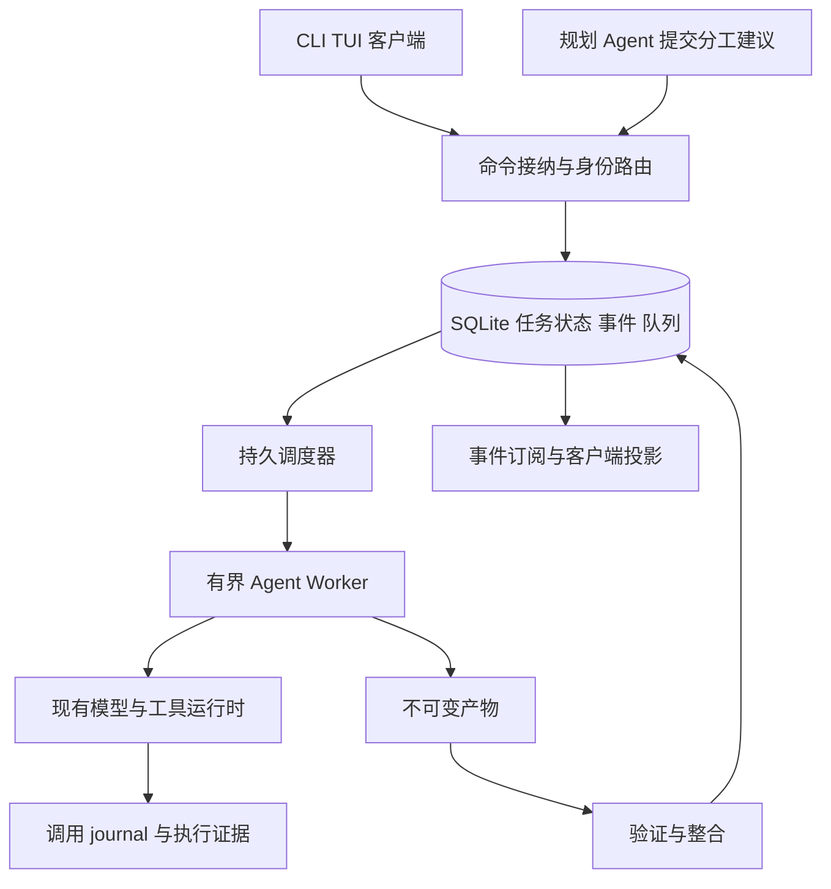

# tnb 长任务运行时与按需 Agent 协作设计

日期：2026-11-03。版本：0.1。状态：设计基线，待审阅。

本方案为 tnb 建立统一的持久任务运行时：先保证单 Agent 任务可以中断恢复，再按任务结构选择临时委派、并行工作流或跨工作区协作。用户控制授权、成本和协作偏好；模型提出分工，运行时决定是否准入。本文规定目标行为与实施顺序，不表示下述接口已经实现。

## 1 目标与交付边界

需要支持的长任务包括跨小时的模块迁移、等待 CI 或用户反馈后继续的改造，以及多工作区共同完成的协议变更。完成条件是版本化产物通过验收，单纯回合结束、worker 退出或模型声称完成不能结束业务任务。

第一版面向一台 macOS 主机、一个本地运行时所有者。CLI、TUI 和其他客户端可连接同一个运行时；客户端断开不取消显式提交的持久任务。主机休眠或关机期间没有计算保证，恢复后处理已经到期的持久计时器。

第一版不提供跨机器高可用，不引入 Temporal，不同时重写现有 Agent loop、工具协议和全部 transcript 存储。自动发布、推送、合并及扩大权限仍按既有用户授权执行。跨工作区通信在后续阶段交付，不能因工具出现在目录中就绕开协作策略。

## 2 源码依据与现状

tnb 基线提交为 `49b8586f68582ccb92bacf81162ded0824563998`。设计采用机制，不复制其他项目的产品流程；以下事实与后文目标行为分开描述。

| 来源与固定源码 | 已存在的机制 | 采用与限制 |
| --- | --- | --- |
| [Codex ToolCallRuntime](https://github.com/openai/codex/blob/57d4fac64adbcaed0523ca6bf8d58c4ef6875157/codex-rs/core/src/tools/parallel.rs#L46) | 保留声明工具时的 StepContext，区分共享与独占执行 | 保存请求上下文与工具绑定；此锁不等于文件事务锁 |
| [DeepSeek Harness SubagentManager](https://github.com/deepseek-ai/deepseek-harness/blob/687f282e8625c6b8d11ff58211a90524be2e4317/packages/subagent/subagent/src/manager.ts#L379) | 创建前捕获委派策略，预留 activation，管理在途创建与关闭 | 启动过程必须计入所有权、容量和取消 |
| [Pi Durable ToolTask](https://github.com/earendil-works/pi/blob/16f5f0af4d85ca583d045ceb5ed6d646fcaf7761/packages/durable/src/harness/tool.ts#L125) | 保存最终参数与 replay 策略，恢复时要求旧、新策略都允许重放 | 保存执行意图；外部副作用仍需要幂等或核对 |
| Claude Code 本地提取 `AgentTool.tsx`、`sessionMemoryCompact.ts` | worktree、后台 Agent、上下文压缩与 Session Memory | 参考隔离与上下文分层；提取版本和功能门控不构成通用恢复保证 |
| [Superagent 领域模型](https://github.com/deepseek-ai/dsh-superagent-prototype/blob/8c32a9dc5d72c033816c6a8110b37f40cf94fba4/src/core/model.ts#L126) | Ticket、Mandate、Assignment 分离 | 对应工作身份、授权与执行尝试；不原样引入其 GitHub/飞书业务模型 |
| [Superagent Effects](https://github.com/deepseek-ai/dsh-superagent-prototype/blob/8c32a9dc5d72c033816c6a8110b37f40cf94fba4/src/app/effects.ts#L40) | SQLite 持久副作用队列，顺序、退避和 generation | 事务中保存待办，提交后执行；不能推导外部 exactly-once |
| [Pizza Reactor](https://github.com/pizza-agent/pizza/blob/ffa72f018e35ec556a71299dfede3fa3884cdbcb/src/core/runtime/reactor.ts#L397) | 事件驱动处理模型、工具和回合生命周期 | UI 与执行视图共用提交事件；不把内存 Promise 视作可持久化状态 |
| [Pizza crash recovery](https://github.com/pizza-agent/pizza/blob/ffa72f018e35ec556a71299dfede3fa3884cdbcb/src/core/runtime/crash-recovery.ts#L135) | 补齐中断工具结果，修复会话配平 | 会话配平与外部效果核对分别实现 |
| [Pizza checkpoint](https://github.com/pizza-agent/pizza/blob/ffa72f018e35ec556a71299dfede3fa3884cdbcb/src/core/runtime/checkpoint.ts#L27) | 文件清单与哈希；restore 当前只读取清单 | 仅参考指纹；不能作为可恢复文件快照 |

tnb 当前可复用的边界：

- [GoalManager](../../../src/services/goals/manager.ts) 持久化目标、回合预算和续跑提醒，尚未关联业务验收证据。
- [WorkflowManager](../../../src/services/workflows/manager.ts) 保存 DAG，但批次 `allSettled` 后才保存结果，中断步骤会归一为 pending；活跃运行集合属于单个 manager 实例。
- [workflow 工具](../../../src/tools/workflow.ts) 调用 Agent 时没有完整的 step、attempt、child checkpoint 关联；显式多 Agent 使用约定主要在工具描述中。
- [TaskManager](../../../src/services/tasks/manager.ts) 已有 attempt 身份、启动归属、取消排空和会话代次检查。
- [ToolRuntime](../../../src/core/tool-runtime.ts) 已有授权、请求执行上下文绑定和 journal 屏障；[CallJournal](../../../src/services/session/call-journal.ts) 只恢复精确 history scope 中的已结算调用。
- [UsageBudget](../../../src/services/usage/budget.ts) 已覆盖一次 invocation 及其后台租约的模型请求；跨 invocation 的运行级额度尚未贯通。

## 3 核心不变量

| 编号 | 不变量 |
| --- | --- |
| I01 | 同一业务任务重启后保留 run/task 身份；新的执行尝试使用新的 attempt 身份 |
| I02 | 只有当前 owner/epoch 可推进任务；旧执行结果可作为隔离证据，不能直接接纳 |
| I03 | 有效派发必须存在已提交的操作意图，并在执行前重新核对授权、取消和前置版本 |
| I04 | 已派发但结果缺失的副作用进入 unknown；错误、超时、取消均不证明效果未发生 |
| I05 | 子 Agent、Skill、Hook、摘要和 MCP 模型请求计入原任务预算；后台不得另开无限额度 |
| I06 | single 策略禁止业务委派；auto 只在已授权范围内选择；multi 不强制并行紧耦合工作 |
| I07 | 只有被当前验收规则接纳的产物可满足下游依赖；结果文本不是验收证据 |
| I08 | 暂停、取消、等待、失败和完成分别持久化；取消意图不能因重启而丢失 |
| I09 | 外部消息可以补充上下文，不能提升权限；审批绑定实际操作、版本与有效期 |
| I10 | 单个任务结算独立提交；状态、事件与应产生的队列工作处于同一数据库事务 |
| I11 | 容量、等待队列、上下文、输出、磁盘增长与重试均有上限；队列满必须明确返回 |
| I12 | 历史验证仅对记录的代码、依赖与环境输入有效；代码变化后重新验收 |

## 4 总体结构



调度器使用确定性代码推进状态，规划 Agent 无权直接写任务表或修改租约。现有模型推理、文件工具、Shell、Skill 和 MCP 继续通过原工具运行时，新增持久上下文适配器。

采用显式持久状态机，不要求从进程开始重放全部 JavaScript。模型决策作为版本化数据提交，恢复使用已接纳的决策；禁止恢复时重新询问模型并无条件派发一套新工具。

## 5 身份与数据模型

| 实体 | 主键与主要字段 | 责任 |
| --- | --- | --- |
| Run | run_id、objective、acceptance_revision、policy_ref、status、deadline、budget_ref、cancel_requested_at | 用户目标和总边界 |
| Task | task_id、run_id、parent_task_id、plan_revision、input_digest、status、current_attempt_id、result_ref | 有明确输入与验收条件的工作 |
| Attempt | attempt_id、task_id、owner_id、lease_epoch、lease_expires_at、checkpoint_ref、status | 一次可中断的执行；不是业务任务 |
| AgentSession | agent_session_id、workspace_id、transcript_ref、task 关联 | 可复用上下文；不充当授权或业务状态 |
| PlanRevision | run_id、revision、base_revision、tasks、edges、reason、decision_ref | 可审计的 DAG 变更 |
| Operation | operation_id、task_id、semantic_key、arguments_digest、attempt_id、journal_ref、state、replay_policy | 一个外部效果意图 |
| Artifact | artifact_id、content_hash、manifest_ref、input_digest、producer_attempt、verification_refs | patch、报告、日志与验收证据 |
| Inbox | message_id、source、external_id、payload_ref、payload_digest、task_id、state | 去重、归属和消费 |
| Outbox | effect_id、kind、key、generation、sequence、due_at、attempts、payload_ref、state | 持久唤醒、投递和受控重试 |
| Approval | approval_id、operation_id、authority_digest、expires_at、decision、actor | 等待用户的可恢复决策 |
| BudgetLedger | run_id、reservation_id、request_id、route、reserved、reported、state | 预留和已报告消耗 |
| Event | run_id、sequence、event_id、command_id、type、causation_id、schema_version、payload_ref | 审计、增量订阅与投影 |

所有身份使用 UUID。Provider tool call ID 只做关联，不能当全局主键。operation 的 semantic_key 在同一逻辑操作重试中保持不变；输入变化必须创建新意图，相同 key 不同 arguments_digest 返回冲突。两个合法的相同参数操作也可以有不同业务身份，不能只用参数哈希去重。

核心唯一约束为 `(run_id, task_id)`、`(run_id, sequence)`、`(task_id, semantic_key)`、`(source, external_id)`、`(effect kind, key)`。任务最多有一个非终态 attempt，通过事务内条件更新约束，不能依赖进程内 Map。

## 6 任务状态与控制语义

任务状态分为：`pending`、`ready`、`running`、`waiting`、`reconciling`、`validating`、`paused`、`succeeded`、`failed`、`cancelled`。waiting 必须带 reason：dependency、timer、approval、message 或 resource，并保存 wake 条件。

| 触发 | 状态变化 | 条件与副作用 |
| --- | --- | --- |
| 任务接纳 | pending → ready/waiting | 验证输入、无环依赖和授权 |
| 成功领取 | ready → running | 同事务创建 attempt、租约和启动 outbox |
| 进入等待 | running → waiting | 提交检查点；没有在途效果后释放执行容量 |
| 产物完成 | running → validating | 产物已持久化，保存完整清单 |
| 验收通过 | validating → succeeded | 检查输入版本、授权、取消与验收规则 |
| 验收不通过 | validating → ready/failed | 新返工意图，消耗有限重试预算；不覆盖旧证据 |
| 崩溃或失联 | running → reconciling | 禁止直接变回 ready；核对 journal、子任务和工作区 |
| 核对结束 | reconciling → ready/validating/waiting/paused | 保存后置证据；未知效果继续阻塞 |
| 暂停 | 非终态 → paused | 停止新派发，保存状态，排空或核对在途操作 |
| 取消 | 非终态 + cancel_requested_at | 关闭后代准入、取消执行，核对效果；排空后进入 cancelled |
| 重试耗尽 | 可重试状态 → paused/failed | 原因区分预算耗尽、停滞和不可恢复错误 |

Run 由任务接纳状态聚合，不能仅凭规划 Agent 的完成文本结束。必需任务全部成功、验收清单满足、没有未知操作和待清理后代，才可 succeeded。可选分支失败要在验收契约中预先允许，并进入最终报告；不得悄悄省略。

`pause` 允许显式恢复，`cancel` 关闭原执行意图。取消后的继续创建显式 successor/返工任务并引用原产物，不将 cancelled 改回 running。worker 停止后仍有无法确认效果时保留 reconciling 并显示取消已请求，不能谎报取消完成。

## 7 单 Agent 与多 Agent 的决策

### 7.1 用户约束

```ts
type ExecutionPolicy = {
  mode: "single" | "auto" | "multi";
  maxActiveAgents: number;
  maxDelegationDepth: number;
  maxModelStreams: number;
  allowParallelWrites: boolean;
  allowedWorkspaceIds: string[];
  maxCostUsd?: number;
  deadline?: string;
};
```

single 使用一个业务执行 Agent，允许上下文压缩和检查点恢复；auto 从单 Agent 开始；multi 优先评估分工收益，但不要求创建固定角色。用户明确指定的 single 优先于项目建议与模型提案。模式约束通过统一准入执行，不只改变工具描述。

### 7.2 决策顺序

1. 按外部请求身份去重，判断消息是否属于现有任务的继续、纠正或验收反馈。
2. 核对已有授权；同一任务后续消息优先交给原任务，用户改变范围则产生新的授权修订。
3. 小范围查找或工具级并发直接执行，不因调用多个工具创建多个 Agent。
4. 有独立目标、输入、产物、验收方式且有上下文隔离收益时，允许串行委派。
5. 有多个当前可执行分支且整合成本可控时，允许并行只读任务。
6. 并行写入还须满足隔离工作区、公共接口稳定、整合所有权明确等条件。
7. 跨项目请求只路由到已授权工作区；目标 Agent 也要独立检查接收权限和任务预算。

模型提案包含 objective、dependencies、input_refs、read/write resources、artifact_type、acceptance、delegation_reason 和 budget_slice。运行时检查身份重复、图无环、权限、配额、深度与冲突；可批准、排队、转串行或拒绝。低置信度时先做有限单 Agent 调查，不使用未经评测的固定分数阈值。

第一版 auto 只允许单 Agent 和受限的只读委派，默认禁止并行写入。并行实现须在工作区隔离阶段完成后启用。对每次拓扑调整保存 PlanRevision，校验 base_revision；已接纳任务不可被新计划静默覆盖。

### 7.3 运行中调整

可在没有在途操作的检查点增加、减少或重新分配任务。正在写入的旧 worker 必须排空，或隔离为不能整合的旧 attempt。输入或公共接口变化时，使受影响任务与验证结果失效，创建新工作修订。已付模型费用和旧产物保留。

## 8 存储与事务

本地持久状态使用 tnb 自有 `bun:sqlite` 适配器，部署在主机本地文件系统。数据库位于 `<TNB_HOME>/runtime/state.sqlite`，模式 WAL、`foreign_keys=ON`、`synchronous=FULL`、有界 busy timeout。远程挂载不属于第一版支持范围。SQLite 单事务负责状态、事件、outbox 与预算预留的一致性。

运行时启动先取得 state 目录所有者锁，再打开数据库和迁移；同一项目的会话执行锁仍生效。客户端通过本机 Unix socket 提交命令和订阅，socket 与数据库文件使用仅当前用户可访问的权限。任务 Worker 不直接访问控制面数据库，只持有当前 attempt 的执行接口。

每条命令携带稳定 command_id、payload_digest 和预期 revision。同 ID 同内容返回原结果，同 ID 不同内容拒绝。更新采用 revision 条件，冲突后重新读取，不覆盖较新状态。状态查询无副作用，不归一化或修复活跃任务。

事件表是业务提交审计；任务表是同事务维护的调度状态，投影丢失时可从已保留事件和快照重建。token chunk 和高频进度不作为关键提交，只保存采样数据及最终响应。外部原始文本、凭据和完整工具输出不能无界写进事件 payload。

产物写入临时路径，计算哈希，sync 并原子改名后提交数据库引用。崩溃产生的未引用产物由保留策略清理；引用缺失或哈希不符进入损坏状态，不能伪造成功。文件清单不能替代内容备份或 Git patch。

第一版保留现有 JSONL transcript 与 call journal。数据库保存精确引用与源 revision；数据库和 JSONL 不在一个事务里，恢复由 journal bridge 按稳定操作身份核对，必须明确未知窗口，不能承诺跨存储原子性。

## 9 正常执行协议

1. 接纳命令，在一个事务中创建/关联 Run、Inbox 与初始 Task，并写入事件和待调度 outbox。
2. 调度器在事务中检查 ready、预算、资源、取消和 policy revision，创建 attempt 与 lease_epoch。
3. Worker 启动前验证 attempt 仍有效，绑定工作目录、模型路由、工具目录和授权上下文。
4. 构建上下文：目标、验收规则、当前任务、已接纳依赖、产物引用、未核对操作与必要近期历史。
5. 模型请求先预留额度，再派发；完整响应通过终止原因、结构和工具参数检查后才保存为决策。截断响应不派发未完成工具。
6. 工具经过现有 PreToolUse、参数再验证、授权与执行绑定；提交操作意图后记录派发，再执行正文。
7. 工具结果先作为执行证据保存，再运行后置 Hook 与模型呈现；观察者失败不改变已发生效果。
8. 每个任务独立提交检查点和产物，不等待同批其他任务结束。
9. 验证器检查产物输入与验收条件；任务成功、事件与依赖唤醒在同一事务提交。

模型输出、子 Agent 报告和工具错误均为不可信输入。结构校验不替代语义验收；所有动态工具仍走现有权限与沙箱边界。

## 10 操作日志与恢复

操作状态为 `intended`、`dispatched`、`settled`、`unknown`。settled 必须另存 effect_outcome：confirmed、not_applied、partial 或 unknown；不能把 `isError=true` 解释成没有副作用。

| 崩溃边界 | 必须执行的恢复 |
| --- | --- |
| 模型请求未形成已提交的完整决策 | 不执行半成品；按模型请求策略重试，保留可能计费的记录 |
| 决策已提交、没有工具意图 | 使用已保存决策，重新校验当前权限和输入 |
| intended、可证明未进入 dispatch | 重新校验后可派发；跨存储缺口不能假设未执行 |
| dispatched、结果缺失 | unknown；先查询后置状态，禁止一律重跑 |
| journal 已结算、DB 未结算 | 按精确 scope 和稳定操作身份接纳原证据，不重复执行 |
| 产物持久化、验收未完成 | 重新关联产物并执行验收 |
| 成功任务的依赖输入已变化 | 保留历史成功记录，创建新的任务修订与验收 |

replay_policy 分为 safe、reconcile、never。safe 还需检查当前工具声明、输入版本、授权和重复成本；reconcile 查询外部幂等键或受控文件后置哈希；never 的未知结果必须交给有权处理者。通用 Shell 默认不能自动推断 safe。

文件核对保存 old_hash 与 intended_new_hash：匹配 new_hash 可证明目标内容满足后置条件，匹配 old_hash 可在重新授权后考虑执行，其他内容为冲突。这不证明计费、发送或远程提交恰好发生一次。

恢复顺序为：取得所有权 → 检查迁移/存储完整性 → 读取取消与暂停意图 → 排空或隔离旧执行 → 核对操作 journal → 核对产物与输入版本 → 重新关联子任务 → 推进可恢复工作。所有未完成 task 先进入 reconciling，禁止查询时把 running 自动改成 pending。

## 11 所有权与容量

第一版单本机 daemon 是唯一调度者；内部异步完成仍可能过期，所以每次结果提交必须校验 task revision、attempt_id 和 lease_epoch。租约只负责控制面所有权，不能阻止任意旧 Shell 写入。

启动任务先预留容量并登记待启动对象，再执行首次异步 Hook 或准备工作。父任务等待子任务时提交 waiting 并释放业务执行槽，但保留任务身份。仍有 Shell、PTY 或其他后代在运行时，保留对应资源槽；禁止释放后让后代脱离计数。

容量分为业务 Agent、模型流、Shell/PTY 和工作区写入资源。申请等待有截止时间；模型流槽在模型 stream 结束或返回时释放，不能跨工具等待持有。多资源申请使用固定顺序；不能持有文件锁等待无限模型配额。

租约过期触发恢复，不立即启动另一个共享工作区写入者。先确认本机旧进程树退出；无法确认时隔离其工作区并暂停接管共享资源。后续分布式能力必须增加外部 fencing 支持，不能把 DB epoch 视为文件系统隔离。

## 12 工作区与产物验收

分析任务使用受限只读工具集。实现任务在业务 Task 对应的独立工作区执行；attempt 默认复用该工作区并先核对，不能每次重试创建新分支掩盖既有修改。失控 attempt 的工作区封存，新的执行从已接纳基线恢复。

并行写任务使用各自 worktree，保存 base_commit、完整 dirty diff/input manifest、依赖锁文件和验证环境摘要。worktree 不隔离端口、网络服务、凭据或外部数据库，这些资源另行分配。

产物先经过文件范围、前置版本、patch 可应用性和测试检查，再由单一整合者应用。整合使用目标版本条件检查，冲突进入新返工任务；多个子任务各自测试通过后，仍对整合版本执行集成验证。最终验证证据绑定实际代码内容而非仅 HEAD。

接受失败不会删除候选 patch 或把同一操作换 ID 重做。必需人工判断保存为 waiting，不让模型无界自我评审直到给出通过。

## 13 上下文、工具、Skill 与 MCP

结构化目标、授权、预算和验收规则从数据库加载；摘要只能整理任务记忆，不能修改这些事实。上下文由当前任务依赖与源 revision 构建，原始日志按需分页。所有执行 Agent 共享相同的压缩与配平校验能力，避免仅主 Agent 有完整压缩路径。

保存工具 schema/实现版本引用、Skill 内容摘要、MCP 服务/目录代次及工作目录等请求绑定信息。恢复时重建连接并比较版本；不兼容变化进入迁移/阻塞，不能按旧工具名猜测兼容。凭据保存引用，运行时重新注入，不放入摘要或普通产物。

子权限为用户授权、当前上级限制、任务范围和 profile 限制的交集。授权收紧即刻影响后续派发；授权放宽需要明确的新 revision。审批保存精确参数摘要、执行目标、policy revision 和有效期；等待后有任一变化则旧审批无效。

## 14 预算、超时与停滞

Run 持久拥有总预算，invocation 是其下的执行片段。现有 UsageBudget 接入 RunBudgetAdapter，所有模型路径包括 Skill 独立 provider、Hook、摘要、记忆与 MCP sampling 使用同一所有权。

请求派发前事务性预留预计 token/金额，返回后按物理路由报告用量并释放未使用预留。恢复时未确认计费请求保留预留并标记 uncertain；不能归零后重发。价格未知时不能执行依赖金额硬限制的策略。Provider 缺失用量或已派发并发请求使真实账单无法严格封顶，需要在界面展示已报告、预留和不确定三项。

分别设定请求超时、工具超时、任务活跃时间预算和 Run 绝对 deadline。等待审批或外部事件可不计活跃时间，但绝对 deadline 不后移。过期先关闭新业务派发，再取消/核对在途操作；必要清理使用有界独立额度，不开启新业务工作。

第一版建议初始值为：单 Run 最多 4 个模型流、进程最多 8 个模型流、最多 64 个排队请求；最多 4 个业务 Agent（含根执行者），委派深度最多 2；同类临时错误最多 3 次，持久退避从 2 秒增长至 60 秒。具体请求/工具超时沿用现有限制，用户可收紧。数值是保守初始配置，需用相同任务和预算评测后校准。

停滞依据相同输入下重复失败签名、没有新产物的重复工具序列、连续无进展 checkpoint 等，计数持久化。达到阈值暂停并保留证据，不靠 worker 心跳证明业务有进展。连续崩溃达到限制后停放，取消清理仍需有界推进。

## 15 Inbox Outbox 与跨工作区协作

消息状态为 persisted、delivered、handled、result_committed、accepted。接收 ACK 只代表消息已持久化；发送者可以结束当前 turn 并释放执行槽，等待结果事件唤醒任务，不需要持续轮询模型。

同一来源外部 ID 唯一，同 ID 不同内容是冲突；消费者幂等处理。状态、接收回执、结果投递 outbox 同事务更新。outbox 至少一次投递，目标 inbox 去重；远程效果仍按 operation 协议核对。保存父 Run、任务、message_id、reply_to、deadline、预算引用和传播深度；自动回传不再触发无限回复链。

工作区 Agent 是可复用上下文持有者，不是任务所有权和无限权限主体。请求需通过目标工作区准入，不向对方开放全部父历史或凭据；答复只进入任务证据，不能变成上级系统指令。

## 16 运维、保留与可观察性

用户可查看任务图、当前执行者、等待原因、最近已验收产物、预算、原始证据和待核对操作；不使用模型编造的百分比代替进度。事件支持按 sequence 断线续订，重复事件由 event_id 去重。

pause/cancel/status 是持久命令；客户端断线不改变任务状态。daemon shutdown 停止准入、记录恢复状态并终止所属执行树，重启后核对。持久任务与传统前台 invocation 的生命周期分别显示，避免把关闭终端误认为任务已取消。

关键状态和错误保留至用户删除 Run；普通日志、旧产物和快照按可配置配额回收，不删除活跃任务、未知操作或未送达消息的恢复证据。达到总磁盘限额时拒绝新任务并停止新效果派发，保留有界清理能力；不静默删除 journal。

SQLite 备份使用一致性备份接口，文件产物同步引用清单与内容；不直接复制一个仍在写入的数据库文件来假定备份完整。schema 和 checkpoint 有显式版本，不兼容时保留原数据并拒绝自动执行；迁移前备份。

## 17 tnb 模块映射与兼容迁移

以下路径是计划新增的边界，不要求第一阶段一次全部建立。

| 模块 | 职责 | 与当前代码的关系 |
| --- | --- | --- |
| `services/runtime/store.ts` | SQLite 事务、迁移、唯一约束 | 新建，保留 SessionStore 原格式 |
| `services/runtime/commands.ts` | 去重命令、revision 和授权 | 统一接入 CLI/TUI/工具 |
| `services/runtime/scheduler.ts` | ready、容量、租约、持久计时器 | 替换仅内存的任务推进 |
| `services/runtime/recovery.ts` | 取消优先、journal 与产物核对 | 复用现有恢复校验，禁止宽松 scope |
| `services/runtime/execution-policy.ts` | single/auto/multi 与所有委派准入 | 接入 agent、workflow、Skill 与跨工作区入口 |
| `services/runtime/outbox.ts` | 持久启动、消息和唤醒 | 借鉴 Effects 的 generation 与退避 |
| `services/runtime/worker.ts` | request/checkpoint/产物适配 | 调用现有 agent-loop，不并行重写 |
| `services/runtime/budget.ts` | Run 预留、报告、进程限流 | 连接 UsageBudget，禁止重复计量 |
| `services/runtime/artifacts.ts` | 不可变内容、验证与整合 | 与已有文件锁、Git 和工作区状态协作 |
| `entrypoints/runtime.ts` | 本机常驻服务、连接与关闭 | CLI/TUI 保留原交互入口 |

新能力先以显式持久运行入口交付，传统前台命令的退出行为不变。新工具/API 名称在实现阶段保持一套语义，不同时建立互不兼容的第二 TaskManager。

旧 Goal、Task 和 Workflow 只做可审计导入，保留源文件与 digest。导入后的业务身份与旧 session/task ID 建映射；没有完整证据的 running 状态进入 reconciling。旧 completed 记录保留为历史报告，只有输入与验收证据满足当前要求时才可作为已接纳依赖。切换后的对象禁止由旧 manager 继续写入；发现旧写入者时阻止接管，不双写。

修订现有 Agent 提示词中“子会话不可恢复”等与代码不一致的描述；模式支持按实际 capability 暴露。旧 workflow 显式请求约定在传统入口保留，新 auto 入口使用结构化执行策略及运行时准入，不能仅改 prompt 宣称具备自动调度。

## 18 分阶段交付与退出标准

| 阶段 | 交付 | 进入下一阶段的必要条件 |
| --- | --- | --- |
| P0 单 Agent 持久执行 | 数据模型、命令、单所有者、独立任务提交、现有 journal bridge、pause/cancel/recovery、产物验收、Run 预算 | macOS 强杀与重启矩阵通过；single 无业务委派；未知效果正确阻塞 |
| P1 按需只读委派 | 策略提案与准入、子任务身份、上下文压缩一致性、父等待释放执行槽 | 同一任务预算比较；取消后代无泄漏；自动模式可解释且能退回单 Agent |
| P2 隔离实现与整合 | worktree、输入版本、资源分配、单一整合、集成验证 | 旧 attempt 不能写入整合工作区；冲突和过期证据正确拒绝 |
| P3 跨工作区协作 | 持久 inbox/outbox、已授权 workspace 注册、消息唤醒与回复关联 | ACK 前后崩溃不丢已接收工作；重复投递不重复业务效果 |

P0 内部实现顺序：存储与状态机 → journal bridge → 单 worker 恢复 → 验收 → Run 预算 → 本机服务与客户端适配。每个可派发路径只有在取消、授权与恢复边界完成后才开放。允许以更小的里程碑交付，禁止先暴露无人值守入口再补恢复。

## 19 验收与故障注入

测试使用脚本模型、本地进程和 loopback 假服务，禁止以真实付费调用证明恢复正确。验收除了最终内容，还要核对真实效果次数、提交顺序和预算记录。只比较最终回答无法发现重复执行。

| 编号 | 场景 | 必须观察到的结果 |
| --- | --- | --- |
| T01 | 同 command_id 重试及不同 payload 冲突 | 原结果复用；冲突拒绝，无第二任务 |
| T02 | 模型半截工具参数、完整响应提交前崩溃 | 不派发未提交工具，保留计费不确定性 |
| T03 | 意图前后、dispatch 前后、结果前后逐点强杀 | 分别恢复或 unknown，无盲目重复 |
| T04 | journal 成功、数据库或 transcript 提交失败 | 用精确引用修复；损坏或 scope 不同则阻塞 |
| T05 | 两个并行步骤，一项完成、另一项未完成时强杀 | 已接纳步骤保留，另一项独立核对 |
| T06 | 旧 attempt 延迟返回、第二客户端竞争启动 | 旧结果不能推进当前 task，无第二有效 owner |
| T07 | 取消与启动 Hook/审批/队列/工具完成竞争 | 不晚启动后代；效果保留；清理完成前不报已取消 |
| T08 | 暂停后重启、取消后重启、主机休眠后恢复 | 保留控制意图；到期任务按持久时间处理 |
| T09 | single 下 agent/workflow/Skill/跨工作区间接委派 | 统一准入拒绝业务子 Agent |
| T10 | 父等子，容量只有一个执行槽 | 父挂起让槽，子可推进，无死锁 |
| T11 | 审批后权限、参数、目录或工具版本变化 | 原审批失效，新派发被拒绝或重新申请 |
| T12 | 多 provider、Hook、摘要、MCP 并发与重启 | 共享 Run 预算，已结算不重复计量，未知消耗不归零 |
| T13 | worktree base 或 dirty 内容变化、多个 patch 整合 | 过期结果拒绝，整合版本重新验证 |
| T14 | outbox 旧 generation 完成时已有新 payload | 不能删除新待办；同 inbox ID 不重复消费 |
| T15 | 文件产物写完、DB 引用前崩溃；引用损坏 | 孤儿可回收；缺失证据不判成功 |
| T16 | 反复失败、无进展、队列/磁盘到限 | 有界暂停、退避或拒绝，不无限循环或无界增长 |
| T17 | schema/Skill/MCP 不兼容变更 | 显式迁移/阻塞，保留原证据和授权限制 |
| T18 | daemon 重启、客户端断线、消息 ACK 前后崩溃 | 恢复任务归属；持久 ACK 对应确实保存的消息 |

每阶段运行必要的类型检查、目标回归、完整 macOS 测试和构建；本轮设计文档本身不构成实现通过。P1 还需要同一任务、相近预算的 single/auto 对比，记录耗时、费用、验收成功率、重复工作和整合失败；不预设多 Agent 一定更优。

## 20 设计审阅要求

按 I01–I12 和 T01–T18 进行场景审阅。阻断级问题必须修订后才进入相应阶段；不能用“模型会注意”代替状态、事务或准入协议。审阅报告记录基线、问题、影响、修订位置和复查结果；代码实现后仍需独立验证。

首个实施决策采用单机 SQLite、显式持久运行入口和禁止自动并行写入。默认额度等运营参数可在实现评测后调整，不能绕开硬性不变量。跨机器运行与自动发布不在本设计承诺范围内。
