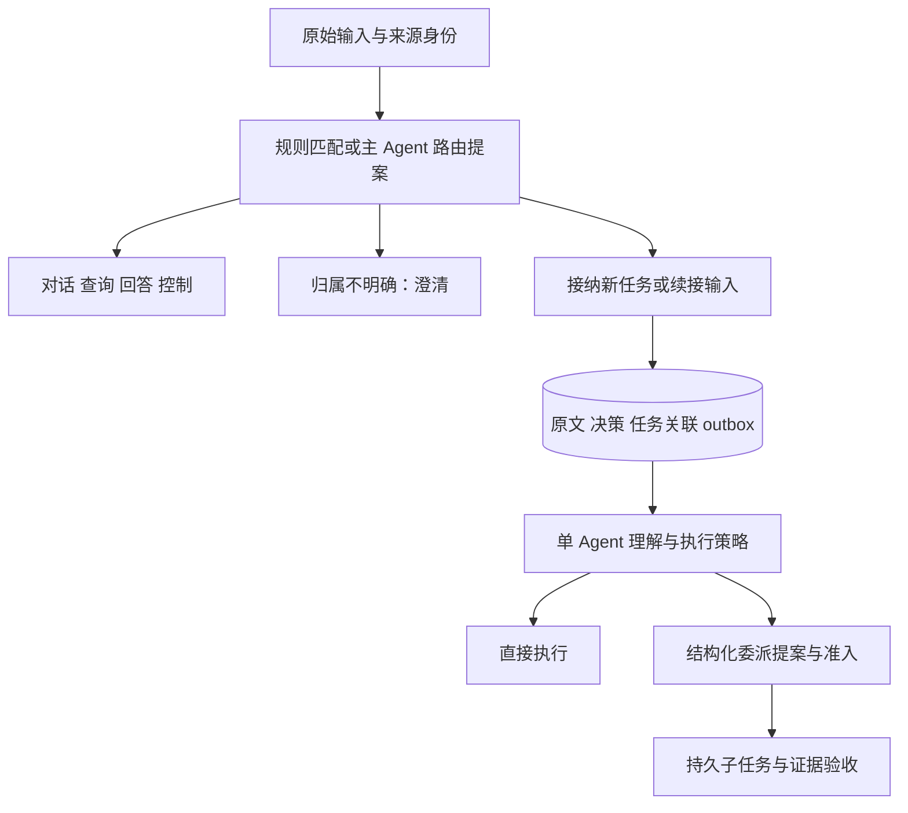

# TNB 输入路由与委派策略修订

日期：2026-11-04。状态：R1–R4 的受限实现已交付，验证及剩余边界见[实现审阅第 15 节](2026-11-03-durable-task-runtime-review.md#15-输入路由与委派策略实现审阅)。差距核对基线：`d7cb45e`。本文件补充[原设计](2026-11-03-durable-task-runtime-design.md)第 4、7、11、18、19 节；下面保留设计依据，实际使用和容量以[运行时文档](../../durable-runtime.md)为准。

## 1 复核结论与源码差距

原设计第 4 节已包含身份路由，第 7.2 节已规定识别续接、纠正与验收反馈，以及结构化委派提案。此前的问题是这些要求未形成可实施的输入/决策/交付协议，代码验收也未将差距明确列出。不能把本次补充说成完全新发现的架构。

DeepSeek Superagent 固定版本为 `8c32a9dc5d72c033816c6a8110b37f40cf94fba4`：[Router 工具](https://github.com/deepseek-ai/dsh-superagent-prototype/blob/8c32a9dc5d72c033816c6a8110b37f40cf94fba4/src/app/tools/main.ts#L47)、[dispatch](https://github.com/deepseek-ai/dsh-superagent-prototype/blob/8c32a9dc5d72c033816c6a8110b37f40cf94fba4/prompts/dispatch.md#L5)、[职责原则](https://github.com/deepseek-ai/dsh-superagent-prototype/blob/8c32a9dc5d72c033816c6a8110b37f40cf94fba4/docs/004-prompts.md)。其主 Session 路由原始 Trigger 为 accept/attach/ignore/stop，不扩展用户需求，技术判断由 Worker 负责。借鉴的是原文归属、幂等决策、职责分离和续接交付；不移植 IM/GitHub 业务流程，也不据此要求 TNB 每次额外调用一个 Router 模型。

| 事项 | 修订前源码事实（`d7cb45e`） | 修订要求 |
| --- | --- | --- |
| 输入接纳 | [conversation-tool.ts](../../../src/services/runtime/conversation-tool.ts) 有 submit/query/answer/control，没有通用 followup 动作 | 输入路由决定与既有命令适配，增加有界补充输入 inbox |
| 目标归属 | 同文件省略 runId 时可回退本会话/工作区最近 Run | 自然语言多目标歧义需澄清；显式命令便捷回退展示实际目标 |
| 控制交互 | [conversation.ts](../../../src/services/runtime/conversation.ts) 在工作区占用时支持控制对话 | 保留该能力，增加原输入身份与路由回执，不另建同业务 Run |
| 模式差异 | [engine.ts](../../../src/services/runtime/engine.ts) 对 auto/multi 配置相同容量，委派门控仅排除 single | multi 有一次有界分工评估；auto 按需；single 是代码约束 |
| 委派提案 | 同文件主要接收 key/prompt/workspace/可选 reason | 证据、范围、交付、必要性与限额形成版本化提案和接纳记录 |
| 子结果验收 | 无 checks 的任务接纳为 report-delivered | 报告送达与分析结论核实分别记录，不能把前者当语义正确 |
| 多终端容量 | [budget.ts](../../../src/services/runtime/budget.ts) 限同 runtime，[CLI](../../../src/entrypoints/cli.ts) 预算为进程内实例 | 后续按资源域协调跨进程请求租约与项目公平排队 |

## 2 两层职责

输入路由回答“输入属于哪个工作、执行什么业务动作”；执行策略回答“已接纳的工作怎样分工”。两类决策分开保存，路由结果不能自己增加实施范围、验收条件、文件/Shell 权限或预算。

显式斜杠命令、带有效目标 ID 的控制、已呈现问题的回答优先按确定性规则处理。自然语言由当前主 Agent 在已有模型回合中给出结构化提案；归属存在歧义时澄清。Router 是明确的代码职责与数据协议，第一版不增加常驻进程，不为每条简单输入额外调用模型。

## 3 输入身份与路由协议

宿主保存不可变输入 `inputId/sourceRef/rawPayloadRef/sessionId/workspace/explicitTarget`，来源身份不能由模型冒充。路由记录至少包含 `decisionId/inputId/action/targetRefs/reasonCode/evidenceRefs/inputRevision/policyRevision/status`；目标依据是明确引用、问题 ID 或用户选择，不是模型自评置信分。

动作分为 chat/query、submit、followup、answer、pause/resume/cancel/limits、clarify。普通讨论不自动提交长任务；followup 不冒充问题回答；控制操作继续受原 revision、审批和状态约束。已获准范围内的路由和只读委派无需反复询问用户，缺失目标、业务选择或新增权限才需要交互。

同工作区有多个 Run 时，不能仅按主题相似或“最新一个”自动把自然语言输入追加到任务，尤其不能据此执行取消等控制。原显式 CLI 的最近任务规则可保留，但必须显示实际目标。跨工作区先核对原授权；同一用户的另一个目录不自动获得许可。未决归属保存为独立的路由问题，复用对话问答组件，不伪造 Worker 的 waitId，不先创建候选业务 Run。

同一输入身份的重投复用决策，不产生第二工作；不同事件中相同文本不自动去重。宿主接纳时重新核对权限、任务状态、input/policy revision。接纳新任务或续接时，原输入、路由决定、关联和 outbox 在同一事务提交；未提交提案不可派发。重启继续已接纳决定，不能重新问模型后再执行另一套动作。拒绝、待澄清和过期提案保留原因及关联输入。

## 4 followup 交付与恢复

入口将补充原文写入目标 Task 的持久 inbox。Worker 在完整工具轮次或安全检查点消费，通过稳定 delivery identity 追加 transcript，再提交消费回执；入口不得直接改写在途模型请求的消息、已派发工具参数或 journal history scope。已有 outbox、delivery 去重和 journal 屏障继续使用。

新增要求更新业务输入修订；旧输入上的 candidate 和验收不能证明新要求已满足。旧操作的效果保留，按当前文件与新要求决定增量工作，不能整体重跑。补充原文自身不授予写入、Shell 或更高费用额度；需要变更授权时走既有明确审批。

暂停任务可以保存输入但不自动恢复；取消不倒退为运行；已完成任务的新要求创建显式 successor，引用原输入和产物，不把 succeeded 改回 running。迟到答案仍绑定原 waitId/版本。未交付输入与交付未确认输入在重启后分别恢复，不遗漏、不重复追加。

## 5 执行策略与委派准入

| 模式 | 目标行为 | 完成证据 |
| --- | --- | --- |
| single | 一个业务 Agent，禁止业务委派；维护性摘要仍受限可用 | 统一准入拒绝，不只依靠隐藏工具 |
| auto | 先单 Agent 理解，出现有价值的独立工作时提出分工 | 实际选择、依据、提案及准入结果可查询 |
| multi | 初步调查后必须评估一次分工；无合理分工可继续单 Agent | 分工评估与不拆分原因持久记录，不强制凑角色 |

初步调查应有轮次/费用上限；评估可合并进已有回合，不每轮额外调用模型。同输入/计划修订不无限重新评估，运行中出现新事实才提出新的有界调整。single 的统一策略适用于已接入的业务入口，尚未接入持久运行时的 workflow/fork Skill/Hook/MCP/插件保持现有 capability 限制，不能提前宣称已覆盖。

提案要求稳定 key、具体问题、已知事实与证据引用、工作范围、独立性理由、预期产物、验收方式、必要/辅助性质和执行限额。运行时检查重复已完成/在途工作、允许目录、依赖关系、权限、深度、预算和容量，不用模型自填收益分数决定准入。

结构不成立则拒绝，资源暂缺则持久排队，接纳则同事务保存 PlanRevision、准入决定、子任务和 outbox。稳定 key 重试不创建第二子任务。建议新策略从两个只读分支、一层委派起步，待同任务基准评测后调整；这是建议初值，不是已证明最优的阈值。旧活跃 Run 的策略和能力绑定不静默改写。

只读子任务提交来源、关键证据和输入版本，父任务核实必要事实再使用；不能把当前 report-delivered 当语义验收。必需分支失败阻塞相应要求；辅助分支失败按事先约定记录、接管和披露，不在失败后改为可选。保留父任务汇总、修复和验收所需额度，已计费和 uncertain 预留不清零。

## 6 实施顺序与退出条件

| 顺序 | 交付 | 验收 |
| --- | --- | --- |
| R1 | 原始输入实体、路由决定、显式命令适配 | 原文身份、目标校验、事务接纳和重试去重 |
| R2 | followup inbox、安全交付、歧义问答与恢复 | 在途 scope 不变，新要求使旧验收失效，暂停/取消不被续接绕过 |
| R3 | auto/multi 差异、完整提案、子结果核实 | 有依据的策略选择，接纳/排队/拒绝可恢复，必要性与验收有约束 |
| R4 | 跨进程容量租约、项目公平排队、目录重叠检测 | 多终端及不同 TNB_HOME 不绕过同资源域额度，持有者崩溃可恢复 |

继续复用 Run/Task/Attempt、持久队列、等待、journal、transcript、Run 预算和上下文压缩。不同 TNB_HOME 的凭据和控制数据仍分开；协调额度不意味着分享秘密。目录冲突检查需要规范路径及祖先/后代关系，不能认为不同路径哈希就足够。每步独立验收后开放 capability，增加 Router 类名或提示词不算完成。

## 7 故障验收要求

| 编号 | 场景 | 必须观察到的结果 |
| --- | --- | --- |
| R01 | 输入重投、决策/outbox 提交前后崩溃 | 已提交决定恢复且只产生一份工作；未提交提案不能派发 |
| R02 | 多 Run 同主题、“继续那个”、歧义选择中断 | 先澄清，不修改候选或创建新 Run，选择关联原输入 |
| R03 | 模型流/工具执行中收到 followup，交付/消费崩溃 | 原调用 scope 和效果不变，安全边界交付一次，无遗漏或重复操作 |
| R04 | 新要求与验收竞争、旧 candidate 延迟提交 | 旧输入版本不能满足新增要求，保留旧证据并增量核实 |
| R05 | 暂停/取消/完成对象收到输入、迟到答案、越权目标 | 不自动恢复/提权/倒退终态，正确创建 successor 或拒绝 |
| R06 | 相同任务 single/auto/multi，有或无独立工作 | single 不委派；multi 有评估；无合理分工可保持单 Agent；选择有依据 |
| R07 | 重复/缺证据提案、队列/预算到限，随后重启 | 接纳/排队/拒绝记录恢复，无重复子任务，不侵占父验收预留 |
| R08 | 必需/辅助失败、伪证据引用、输入过期 | 不把报告送达当结论正确；按预先合同阻塞或接管 |
| R09 | 多终端、多 TNB_HOME、崩溃租约、目录别名/父子重叠 | 同域额度不能被分进程绕过，公平排队，冲突目录不能同时写 |

原设计 I01–I12、T01–T27 继续有效；R01–R09 的实现、测试映射及未覆盖维度见实现审阅第 15 节。路由准确率仍需对有明确期望归属的样本评测，并分别统计误新建、误续接、误控制、澄清率和额外延迟。single/auto/multi 还需同任务相近预算比较验收成功率、重复工作、耗时与用量；不能凭少数演示预设多 Agent 更优。

## 8 交付映射与收敛范围

R1/R2 由 `routing.ts`、schema v3、命令事务、Task inbox、安全轮次交付及原问答组件承接。新增 `followup/routing`、显式 successor 和来源身份；chat/query 仍是原对话路径，不建立每句话的持久路由实体。已有 `limits` 维持原修订和审计协议。原文直接有界存入路由记录，没有单独实现所有设计字段对应的 Ref 实体。

R3 由 `delegation.ts` 和 engine 中的策略/提案/结构化提交/父复核实现，复用现有 plan revision 和子任务队列，没有单独建立通用 DAG 规划器。新 auto 的活跃容量/批次为 2，新 multi 为 4，默认深度 1；旧 Run 继续原策略。`input` 证据只能证明需求来源，工具证据只能证明实际成功调用，scope 是工作合同而非额外文件隔离；模型复核不等同于语义正确性的形式证明。

R4 由 usage coordinator 的同用户 SQLite 租约、资源域项目排队和 workspace 规范路径重叠检查承接。覆盖接入当前预算包装器的前台与持久 Worker，请求摘要同样受控；不声称限制未接入的第三方请求、旧客户端或远端主机。

当前无持久 Skill/MCP、子 Agent 并行编码、自动合并、分布式 owner；无任务质量基准或数小时 soak。路由历史有 10,000 条上限，未提供独立清理/撤销命令；这项维护限制明确保留，不静默删除身份导致重投新建业务。
